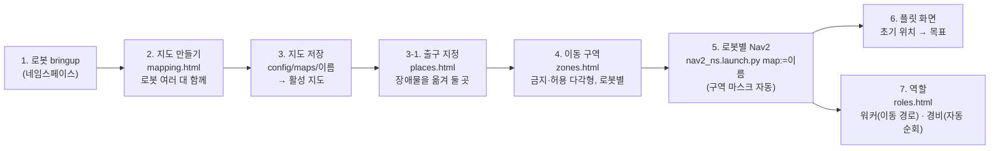

# 로봇 관제센터 (웹)

TurtleBot3 와 Pinky Pro 여러 대를 브라우저에서 관제하는 웹 앱입니다. **PC 에서** 실행하며, 웹 때문에 로봇에 추가로 설치하는 것은 없습니다.
여러 대는 **같은 ROS_DOMAIN_ID + 로봇별 네임스페이스**(`/tb3_01`, `/pinky_01` …)로 구분하고, rosbridge 하나로 모두 연결합니다.

```
브라우저 ──WebSocket(9090)── rosbridge + rosapi (PC) ──DDS(ROS_DOMAIN_ID=30)── /tb3_01/*  /pinky_01/*  /pinky_02/* …
        └─HTTP(8080)── ros2-fleet-console/serve.py (정적 파일 + /api/*, 모드·경보 DB)
```

구조와 데이터 흐름: [docs/architecture.md](docs/architecture.md)

## 실행

```bash
cd ~/turtlebot3
pixi run web                                # http://localhost:8080/fleet.html
pixi run web http_port:=8000 ws_port:=9091  # 포트 변경
pixi run web bind:=127.0.0.1                # 이 PC 에서만 접속 (웹·rosbridge 모두)
```

### Conda를 활성화하지 않고 ROS 2 명령 실행

프로젝트에 설치된 RoboStack Jazzy 환경을 직접 활성화하지 않고 쓰려면 `bin/ros2` 실행 래퍼를 사용합니다.

```bash
./bin/ros2 topic list
./bin/ros2 launch ros2-fleet-console/robot/nav2_ns.launch.py namespace:=tb3_01 frame_prefix:=tb3_01/ map:=lab
./bin/ros2 run rosbridge_server rosbridge_websocket
```

### ROS 환경 (RoboStack)

웹 서버·rosbridge·지도 만들기(slam_toolbox)·Nav2·경로 실행기·경비 노드는 모두 프로젝트 안의 RoboStack 환경 `.robostack/jazzy` (ROS 2 Jazzy, Python 3.14)에서 돕니다. `bin/ros2`(그리고 `pixi run web`)가 이 환경으로 실행합니다. 시스템의 `/opt/ros/jazzy` 는 쓰지 않습니다.

| 들어 있는 것 | 패키지 (robostack-jazzy, 빌드 31) |
| --- | --- |
| ROS 기본·RViz | `ros-jazzy-desktop` |
| 웹 연결 | `ros-jazzy-rosbridge-suite` 2.7.1 |
| 지도 만들기 | `ros-jazzy-slam-toolbox` 2.8.5 |
| Nav2 (AMCL·지도 서버·waypoint follower·keepout 필터 등) | `ros-jazzy-navigation2`, `ros-jazzy-nav2-bringup` 1.3.14 |
| TurtleBot3 서비스 타입 (사운드) | `ros-jazzy-turtlebot3-msgs` 2.4.0 |

새 PC 에 같은 환경을 만들 때 (RoboStack 의 `ros-jazzy-*` 는 껍데기이고 실제 파일은 Python 버전별 `ros2-*` 패키지에 있어, 버전·빌드를 고정해야 빨리 풀립니다):

```bash
conda create -y -p .robostack/jazzy -c robostack-jazzy -c conda-forge python=3.14 "ros2-distro-mutex=0.21.0=jazzy_31" \
  "ros-jazzy-desktop=*=*_31" "ros-jazzy-rosbridge-suite=2.7.1=*_31" "ros-jazzy-slam-toolbox=2.8.5=*_31" \
  "ros-jazzy-navigation2=1.3.14=*_31" "ros-jazzy-nav2-bringup=1.3.14=*_31" "ros-jazzy-turtlebot3-msgs=2.4.0=*_31"
```

- 이 PC 의 환경 기록: 처음(rev 0) desktop + rosbridge, rev 1 (2026-11-24) 에 slam_toolbox·Nav2·turtlebot3_msgs 추가. 되돌리기: `conda install -p .robostack/jazzy --revision 0`
- **자동 탐색(explore_lite)은 RoboStack 에 없습니다.** 지도는 로봇을 조종하며 만듭니다 (자동 탐색을 쓰려면 m-explore-ros2 를 소스로 빌드해야 함).
- 셸이 `/opt/ros/jazzy` 를 불러와 `PYTHONPATH` 에 그 경로가 있어도, 환경의 패키지가 먼저 쓰입니다 (확인함).

### RoboStack 에 없는 인터페이스 패키지 (ros2_ws)

웹이 로봇 서비스를 부르려면 rosbridge 가 그 타입을 알아야 합니다. RoboStack 에 없는 패키지(예: Pinky 의 `pinky_interfaces`)는 소스를 `ros2_ws/src/<패키지>` 에 넣고 `ros2_ws/build.sh` 의 `packages` 목록에 이름을 넣은 뒤 빌드합니다. `bin/ros2` 는 `ros2_ws/install` 이 있으면 자동으로 함께 불러옵니다. 지금은 빌드할 패키지가 없습니다.

```bash
./ros2_ws/build.sh        # 빌드 결과 ros2_ws/build·install 은 저장소에 넣지 않음. 빌드한 뒤 웹 서버를 다시 켜야 반영
```

### 운영 모드와 로봇 역할

플릿 전체가 하나의 **모드**로 움직이고, 운영 모드에서는 로봇마다 **역할**대로 움직입니다. 모드는 상단바의 **모드 칩**, 역할은 **역할**(`roles.html`) 화면에서 바꿉니다 (관리자 토큰 필요).

| 모드 | 하는 일 |
| --- | --- |
| 운영 | 로봇마다 역할대로: **워커**는 이동 경로 반복, **경비**는 지도 전체를 돌며 새 장애물 감시, 역할 없는 로봇은 수동 조종 |
| 지도 만들기 | 고른 로봇들이 **함께** 지도를 그림 (로봇마다 slam_toolbox → 시작 위치로 합쳐 `/map_merged`). 수동 조종 또는 **자동 탐색**(Nav2 + explore_lite). 저장 → 활성 지도 → **출구 지정**. 이 모드로 바꾸면 워커·경비는 모두 **멈춤** |
| 장애물 처리 | 운영 중 경비가 지도에 없던 장애물을 찾으면 **서버가 자동으로** 바꿈 (출구가 있을 때). 워커·경비가 모두 모여 5초 소리 → 함께 장애물을 출구로 밀기 → 5초 소리 → 운영으로 돌아가 각자 역할 (아래 "장애물 처리"). 사람이 고를 수는 없고, 배너의 **중단**·전체 비상정지로 멈춤 |

| 역할 | 하는 일 | 시작·멈춤 |
| --- | --- | --- |
| 워커 | **이동 경로**(`routes.html`)에서 할당한 경로를 정한 횟수(0 = 계속)만큼 반복 | 역할 화면 또는 이동 경로 화면 |
| 경비 | 기준 지도에서 갈 수 있는 곳을 빠짐없이 도는 지점을 **스스로 만들어** 반복하며 LiDAR 스캔을 기준 지도와 비교. **지도에 없던 장애물**을 찾으면 그 자리에 멈춰 소리로 알리고, 관제실이 그 경보를 처리하거나 **재개**할 때까지 기다림 (아래 "경비 역할") | 역할 화면 (멈춤·재개는 경비 화면에서도) |
| 역할 없음 | 스스로 움직이지 않음. 대시보드·모바일에서 수동 조종 | — |

- 역할은 `data/fleet.db` 의 `robot_roles` 에 저장됩니다. 역할을 바꾸면 하던 일은 멈춥니다 (워커 → 경로 멈춤, 경비 → 경비 정지).
- 예전의 플릿 전체 '경비 모드'와 사람이 찍던 순찰 경로는 없어졌습니다 (경비 역할로 대체). 예전 `config/mode.json` 이 경비 모드였으면 서버가 운영으로 바꿉니다.

### 처음 시작: 지도 만들기 → 이동 구역 → 로봇별 Nav2 → 역할



1. 로봇들을 네임스페이스로 bringup 합니다 (아래 표).
2. 플릿 화면에 지도가 없으면 **지도 만들기** 안내가 뜹니다. **지도 만들기**에서 함께 그릴 로봇들을 고르고 각자의 **시작 위치**(첫 로봇 기준 x, y, 각도)를 넣은 뒤 **시작**합니다. 로봇마다 slam_toolbox 가 뜨고, 시작 위치로 맞춰 합친 지도(`/map_merged`)가 화면에 보입니다. 웹에서 로봇을 골라 조종하거나 **자동 탐색**을 켭니다. 다 그렸으면 이름을 붙여 **저장**(활성 지도로 지정)하고 **끝내기**.
   - 저장하면 **다음: 출구 지정**으로, 끝내기를 누르면 활성 지도에 출구가 없을 때 바로 **출구 지정**(지점 화면)으로 갑니다. 출구는 장애물 처리 때 로봇들이 장애물을 밀어 옮겨 둘 곳입니다 (지도의 빈 곳).
   - 시작 위치는 줄자로 재서 넣습니다. 틀리면 합친 지도에 벽이 두 겹으로 보입니다.
   - 자동 탐색은 로봇 TF 가 로봇별 토픽(`/tb3_01/tf`)일 때만 됩니다 (Nav2 를 로봇마다 띄우기 때문).
3. **이동 구역**에서 그 지도 위에 금지(빨강)·허용(초록) 구역을 그리고, 구역마다 적용할 로봇을 고른 뒤 **저장하고 적용**합니다.
4. 로봇마다 Nav2 를 띄웁니다. 활성 지도의 구역 마스크가 있으면 자동으로 Nav2 keepout 필터가 켜집니다.
   ```bash
   pixi run ros2 launch ros2-fleet-console/robot/nav2_ns.launch.py namespace:=tb3_01 frame_prefix:=tb3_01/ map:=lab
   pixi run ros2 launch ros2-fleet-console/robot/nav2_ns.launch.py namespace:=pinky_01 map:=lab
   ```
5. 플릿 화면에서 로봇마다 **초기 위치**를 찍고 **목표 지정**.

6. **역할**(`roles.html`)에서 로봇마다 **워커** 또는 **경비**를 고릅니다. 워커는 **이동 경로**에서 경로를 할당한 뒤 **시작**, 경비는 **경비 시작**을 누르면 지도 전체를 스스로 돕니다. 둘 다 Nav2 `follow_waypoints` 로 움직입니다.

구역을 나중에 바꿔 저장하면 실행 중인 Nav2 에 바로 반영됩니다 (재시작 불필요). 경비의 순회 지점도 구역·지도·간격이 바뀌면 5초 안에 다시 만들어집니다.

### 로봇 쪽 (네임스페이스로 bringup)

자세한 순서·확인 방법·문제 해결: [robot/README.md](robot/README.md)

| 로봇 | 명령 | 웹 등록 값 (네임스페이스 / TF 토픽 / TF 접두사) |
| --- | --- | --- |
| TurtleBot3 + 로봇별 Nav2 | `ros2 launch tb3_ns.launch.py namespace:=tb3_01` ([robot/tb3_ns.launch.py](robot/tb3_ns.launch.py) 를 로봇에 복사) | `/tb3_01` / `/tb3_01/tf` / `tb3_01/` |
| TurtleBot3 (조종·모니터링만) | `ros2 launch turtlebot3_bringup robot.launch.py namespace:=tb3_01` | `/tb3_01` / `/tf` / `tb3_01/` |
| Pinky Pro | `ros2 launch pinky_ns.launch.py namespace:=pinky_01` ([robot/pinky_ns.launch.py](robot/pinky_ns.launch.py) 를 Pinky 에 복사) | `/pinky_01` / `/pinky_01/tf` / (비움) |
| 기존 단일 로봇 | 네임스페이스 없이 bringup | (비움) / `/tf` / (비움) |

- 모든 로봇과 PC 의 `ROS_DOMAIN_ID` 가 같아야 합니다 (현재 30).
- TurtleBot3 Jazzy bringup 은 `namespace` 인자를 지원하고, TF 프레임에 `tb3_01/` 접두사를 붙여 전역 `/tf` 로 보냅니다. 로봇별 Nav2 는 `<ns>/tf` 를 읽으므로 그때는 `tb3_ns.launch.py` 로 TF 도 `/tb3_01/tf` 로 보냅니다.
- Pinky Pro bringup 은 namespace 인자가 없고 TF 프레임 이름이 고정(`odom`, `base_footprint`)이라, 래퍼 launch 가 네임스페이스를 씌우고 TF 를 `/pinky_01/tf` 로 분리합니다. LED·표정 서버도 같은 네임스페이스로 함께 띄웁니다.
- 공유 지도 위에 로봇을 그리려면 각 로봇의 `map → <접두사>odom` TF 가 필요합니다 (로봇별 AMCL 또는 SLAM). 없으면 카드·표에는 보이지만 지도에는 "지도 위치 없음" 으로 표시됩니다.
- 로봇별 Nav2 는 PC 에서 `pixi run ros2 launch ros2-fleet-console/robot/nav2_ns.launch.py namespace:=tb3_01 frame_prefix:=tb3_01/ map:=...` 로 띄웁니다. 로봇 종류는 `config/fleet.json` 에서 네임스페이스로 찾아, 파라미터 파일(TurtleBot3 `config/nav2/burger.yaml`, Pinky `config/nav2/pinky.yaml`)과 cmd_vel 타입(`stamped`)을 자동으로 고릅니다. 그다음 플릿 화면의 **초기 위치**로 AMCL 을 시작합니다. 자세히: [robot/README.md 7장](robot/README.md#7-nav2--공유-지도)

### 로봇 등록

`로봇 등록` 페이지(`setup.html`)에서:
1. **네임스페이스 자동 검색** → 토픽 목록에서 `<ns>/odom` 을 찾아 종류(TurtleBot3/Pinky)를 추정합니다.
2. **폼에 채우기** → 이름·색 확인 → **연결 테스트**(토픽·서비스·TF 프레임 확인) → **목록에 추가** → **저장**.

저장하면 `ros2-fleet-console/config/fleet.json` 에 기록됩니다. 직접 편집해도 됩니다.
`config/` 의 현장별 파일(`fleet.json`, `mode.json`, `maps/`, `zones/`, `masks/`, `patrol/`)과 `admin_token` 은 PC 마다 달라 저장소에 넣지 않습니다 (`.gitignore`). 새로 받은 저장소에서는 로봇 등록부터 하면 됩니다. 저장소에 들어 있는 `config/` 파일은 Nav2 파라미터 `config/nav2/burger.yaml`·`pinky.yaml` 둘뿐입니다.
저장에는 **관리자 토큰**이 필요합니다. 처음 저장할 때 묻고 그 브라우저에 기억합니다. 토큰은 처음 실행할 때 `ros2-fleet-console/config/admin_token` 에 만들어지고(권한 600), `cat ~/turtlebot3/ros2-fleet-console/config/admin_token` 으로 확인합니다. 환경 변수 `TB3_WEB_TOKEN` 으로 정할 수도 있습니다.

## 페이지

| 페이지 | 기능 |
| --- | --- |
| `fleet.html` 플릿 | 로봇 카드(상태·배터리·작업·조종자), 공유 지도(로봇별 색, **앞으로 갈 길**, 목표, 선택 로봇 LiDAR, 로봇 간 최소 거리), 선택 로봇에 **초기 위치**·Nav2 목표·**지점으로 보내기**, 종류별 장치 패널, 상태 비교 표, 전체 이벤트 |
| `index.html?robot=<id>` 로봇 대시보드 | 한 로봇의 실시간 뷰, WASD/버튼 조종, 위치·속도, 토픽 주기, 로그(이 로봇만 필터) |
| `interfaces.html` ROS 2 인터페이스 | 전체 노드·토픽·서비스·액션·파라미터 탐색과 호출 (쓰기 잠금) |
| `mobile.html?robot=<id>` 모바일 조종 | 로봇 전환 칩, 조이스틱, 미니 LiDAR, Pinky 표정·LED 바로가기 |
| `setup.html` 로봇 등록 | 위 "로봇 등록" 참고 |
| `mapping.html` 지도 만들기 | 함께 그릴 로봇들과 시작 위치 → 로봇별 slam_toolbox + 합친 지도(로봇별 기여 면적) → 수동 조종 또는 자동 탐색 → 저장(활성 지도 지정) → 끝내기 |
| `roles.html` 역할 | 로봇마다 역할(역할 없음·워커·경비) 지정, 워커의 이동 경로 시작·멈춤·이어서·정지와 진행, 경비 시작·멈춤·재개·정지와 상태(순회 지점·바퀴, 장애물 앞 대기와 그 경보) |
| `patrol.html` 경비 | 경보 목록(미확인/전체), 지도 위 경보 상자·경비 로봇의 자동 순회 지점·로봇, 경보 상세(기준 지도 vs 발견 당시 스캔), 처리(이상 없음·오탐·다시 열기·기준 지도에 반영·가까운 경비 로봇 보내기·링크), 경비 로봇 상태(멈춤/재개), 순회 간격·감지 설정 |
| `alerts.html` 경보 (모바일) | 휴대폰용 경보 목록·상세·처리, 이 기기 알림 켜기, 전체 비상정지 |
| `zones.html` 이동 구역 | 저장된 지도 위에 금지/허용 다각형 그리기, 로봇별 적용, 로봇별 미리보기, 저장 시 Nav2 keepout 마스크 생성·즉시 반영 |
| `routes.html` 이동 경로 | 지점을 이은 경로 만들기·고치기·지우기, 로봇별 경로·반복 횟수 할당, 시작·멈춤·이어서·정지, 진행(바퀴·지점) 표시, 지도 위 로봇의 앞으로 갈 길 |
| `places.html` 지점 | 저장된 지도를 클릭해 좌표를 찍고(끌면 도착 방향) 이름·메모를 붙여 저장, 로봇 현재 위치로 추가, 이름·좌표·방향 고치기, 다시 찍기, 삭제, 검색 |

### 지도 위 '앞으로 갈 길'

플릿·이동 경로·경비 화면의 지도는 움직이는 로봇마다 로봇 색으로 앞으로 갈 길을 그립니다 (레이어 **경로**로 켜고 끔).

| 표시 | 뜻 | 어디서 |
| --- | --- | --- |
| 실선 + 끝 점 | **지금 가는 길**: Nav2 가 계획한 경로 중 아직 안 간 부분, 끝 점 = 지금 가는 곳 | `<ns>/plan` (Nav2 는 주행 중 1초마다 다시 계획). 누가 보낸 목표든(웹 목표 지정, 워커, 경비) 같음 |
| 점선 + 작은 점, 고리 | **앞으로 들를 지점**: 워커는 이동 경로의 이번 바퀴에 남은 지점, 경비는 순회에 남은 지점. 고리 = 다음 지점 | 워커 `/api/assignments`(2초), 경비 `/fleet/patrol_status`(1초) |

- 도착·취소·멈춤으로 계획이 3초 넘게 오지 않으면 그 로봇의 길은 지도에서 사라집니다 (예전에는 마지막 계획이 남아 있었음). 로봇 대시보드의 계획 경로도 같습니다.
- 진행(지점 번호)은 1~2초 늦게 올 수 있어, '다음 지점'은 지금 계획이 끝나는 곳에 가장 가까운 지점으로 맞춥니다.

### 지점 (이름 붙인 좌표)

**지점** 화면에서 지도를 고르고 **지도에 지점 찍기** → 지도를 클릭(클릭한 채 끌면 끈 방향이 도착 방향) → 이름을 넣고 **저장**합니다.
로봇을 원하는 자리에 세워 두고 **로봇 위치로**에서 로봇을 고르면 그 로봇의 지도 위 위치·방향으로 채워집니다 (활성 지도일 때만).

- 저장 위치: `data/fleet.db` 의 `places` 테이블 (`map, name, x, y, yaw, note, created_at, updated_at`). 지도마다 따로이고, 같은 지도 안에서 이름은 겹칠 수 없습니다 (지도당 최대 500개). 표 구조는 아래 [데이터베이스](#데이터베이스-sqlite).
- 좌표는 그 지도의 `map` 프레임(m), `yaw` 는 라디안입니다. 다른 프로그램에서도 바로 읽을 수 있습니다:
  ```bash
  sqlite3 ros2-fleet-console/data/fleet.db "SELECT name, x, y, yaw FROM places WHERE map = 'lab'"
  ```
- 플릿 화면은 활성 지도의 지점을 지도에 보여 주고(레이어 **지점**), **지점으로 보내기**로 선택한 로봇에 Nav2 목표를 보냅니다.
- API: `GET /api/places?map=<지도>`, `POST /api/places`, `PUT|DELETE /api/places/<id>` (쓰기는 관리자 토큰).
- 이동 경로에서 쓰는 지점은 지울 수 없습니다 (경로에서 먼저 빼기). 지점을 옮기면 그 지점을 쓰는 경로도 따라 바뀝니다.

### 이동 경로 (로봇별 반복)

**이동 경로**(`routes.html`)에서 지점을 순서대로 이은 경로를 만들고, 로봇마다 경로와 **반복 횟수**를 할당해 돌립니다.

1. **+ 새 경로** → 지도에서 지점을 차례로 클릭(또는 "지점 추가"에서 고르기) → ↑↓ 로 순서, ✕ 로 빼기 → **저장**. 마지막 지점 다음에는 첫 지점으로 돌아가 다음 바퀴를 돕니다. 같은 지점을 여러 번 넣을 수 있습니다 (연달아는 안 됨).
2. 아래 **로봇별 할당**에서 로봇마다 경로와 반복 횟수(0 = 멈출 때까지 계속)를 고르고 **할당 저장**.
3. **시작**(1바퀴째 첫 지점부터) · **멈춤**(진행 유지) · **이어서**(멈춘 바퀴·지점부터) · **정지** · **해제**.

| 상태 | 뜻 |
| --- | --- |
| 정지 | 할당만 되어 있음 |
| 실행 중 | 서버의 실행기가 Nav2 로 보내는 중 (`2/5바퀴 · 다음 지점 3/4`) |
| 멈춤 | 사용자 멈춤·전체 비상정지·모드 변경·서버 재시작. **이어서**로 그 자리부터 |
| 완료 | 반복 횟수만큼 돌았음 |
| 실패 | Nav2 가 지점에 못 감·거부, Nav2 가 30초 넘게 없음 등 (사유 표시). **이어서**로 실패한 지점부터 다시 |

- 실행: 서버가 `robot/route_runner_node.py` 를 띄워, 실행 중인 로봇마다 Nav2 `<ns>/follow_waypoints` 로 **한 바퀴씩** 보냅니다 (지점의 방향 yaw 포함). 진행(바퀴 수·지점 순번)은 DB 에 기록됩니다. 로그: `logs/routes.log`.
- 실행 중에 경로를 고치면 진행 중인 goal 을 취소하고 바뀐 경로로 이어서 갑니다. 반복 횟수는 실행 중에도 바꿀 수 있고, 할당 경로를 바꾸거나 할당을 해제하려면 먼저 멈춤·정지합니다.
- **시작**할 때마다 새 실행(run)이 만들어지고, 끝나지 않은 이전 실행은 "새로 시작해서 닫음"으로 정지됩니다. 로봇 줄의 **이력**에서 최근 실행 5개와 그 안의 일(시작·멈춤·이어서·바퀴 완료·실패·경로 수정)을 봅니다. 경로를 지워도 실행 이력은 경로 이름과 함께 남습니다.
- 로봇 목록(fleet.json)에서 빠진 로봇의 할당은 "로봇 목록에서 빠짐"으로 아래에 보이고, 정지·해제만 됩니다.
- 시작·이어서는 **워커 역할**인 로봇이고, **운영 모드**이며 경로의 지도가 **활성 지도**일 때만 됩니다 (워커가 아니면 할당 줄에 "워커 아님"). 로봇마다 Nav2 가 떠 있고 초기 위치가 잡혀 있어야 합니다.
- 지도 만들기 모드로 바꾸거나 워커 역할을 그만두면 이동 경로는 멈춥니다.
- 저장: `data/fleet.db` 의 `routes`, `route_points`, `route_assignments`(로봇·경로·`repeat_count`), `route_runs`(실행마다 상태·진행), `route_run_events`(이력). 아래 [데이터베이스](#데이터베이스-sqlite).
- API: `GET /api/routes?map=`, `POST /api/routes`, `PUT|DELETE /api/routes/<id>`, `GET /api/assignments`, `GET /api/assignments/<로봇>/runs`, `PUT|DELETE /api/assignments/<로봇>`, `POST /api/assignments/<로봇>/start|resume|pause|stop`, `POST /api/assignments/pause-all`. 멈춤·정지·pause-all 은 토큰 없이(같은 출처만), 나머지 쓰기는 관리자 토큰.

### 경비 역할: 자동 순회 · 장애물 발견 시 멈춤과 알림

경비 역할인 로봇은 **역할** 화면의 **경비 시작**으로 시작합니다. 서버가 경비 노드(`robot/patrol_node.py`, 로그 `logs/patrol.log`)를 띄우고, 노드가 죽으면 다시 띄웁니다.

1. **순회 지점 자동 생성** ([coverage.py](coverage.py)): 기준 지도의 빈 칸 중 벽·모르는 곳에서 (몸체 반지름 + 12 cm) 이상 떨어지고 그 로봇의 이동 구역 안인 곳, 그중 로봇이 있는 곳과 이어진 영역을 **간격**(기본 1 m, 경비 화면 설정) 격자로 덮고, 격자에서 빠진 좁은 곳(복도 등)은 지점을 더 채웁니다. 아래 줄부터 지그재그 순서로 돌고, 다 돌면 처음부터 다시 돕니다. 경비 로봇이 여럿이면 이 순서를 이어진 덩어리로 나눠 **구역을 나눠 맡습니다** (로봇이 늘거나 줄면 다시 나눔).
2. **감시**: 도는 동안 스캔을 기준 지도와 비교합니다 (아래 "무엇을 경보로 보나").
3. **장애물 앞 대기**: 경비 중에 **지도에 없던 장애물(새로 생긴 것)** 경보를 새로 만들면 그 자리에 멈추고(goal 취소) 상태가 **장애물 앞 대기**가 됩니다. **활성 지도에 출구가 있으면 곧바로 장애물 처리 모드로 넘어갑니다** (아래 "장애물 처리"). 출구가 없으면 기다리는 동안 `alarm_interval`(기본 5초)마다:
   - TurtleBot3: 부저 `<ns>/sound` (ERROR 소리)
   - Pinky Pro: LED 빨강 깜빡임 + LCD 표정 `angry` (`pinky_interfaces` 를 `ros2_ws` 에 빌드했을 때. 없으면 로그만 남기고 건너뜀)
   - 관제 웹: 모든 화면 상단에 **장애물 대기** 배지와 경고음, 알림 토스트 (경보 보기)
4. **다시 경비**: 경비 화면에서 그 경보를 **이상 없음·오탐·기준 지도에 반영**으로 처리하면 스스로 멈춘 지점부터 다시 돕니다. 처리하지 않고 역할·경비 화면의 **재개**를 눌러도 됩니다 (그 경보는 열린 채 남고, 같은 경보로는 다시 멈추지 않음).

- '사라진 것' 경보는 기록·알림만 하고 멈추지 않습니다. 이미 열려 있는 경보를 다시 본 것도 멈추지 않습니다 (새 경보를 만들 때만).
- 경비 상태: 정지 · 경비 중 · 멈춤(사용자·전체 비상정지·지도 만들기 모드·서버 재시작) · 장애물 앞 대기. `data/fleet.db` 의 `robot_roles.guard_state` 에 있고 경비 노드가 1초마다 읽습니다. 서버를 다시 켜면 경비 중이던 로봇은 **멈춤**이 되어 스스로 다시 출발하지 않습니다.
- 지도 위 위치(초기 위치)를 아직 모르는 경비 로봇이 있으면 순회 지점을 만들지 않고 기다립니다 ("위치 기다림").
- API: `GET /api/roles`, `PUT /api/roles/<로봇> {role}`(토큰), `POST /api/roles/<로봇>/guard/start|resume`(토큰), `POST /api/roles/<로봇>/guard/pause|stop`(토큰 불필요, 같은 출처만). 전체 비상정지(`POST /api/assignments/pause-all`)는 경비도 멈춥니다.

### 장애물 처리 (워커·경비가 함께 장애물을 출구로)

운영 모드에서 경비가 **지도에 없던 장애물**을 찾고 **활성 지도에 출구**가 있으면, 서버가 **장애물 처리** 모드로 바꿉니다 (`obstacle_watchdog`, 1초마다 확인). 워커의 이동 경로와 경비를 모두 멈추고(무엇이 돌고 있었는지 기억), 처리 노드 `robot/obstacle_node.py`(로그 `logs/obstacle.log`)를 띄웁니다.

| 단계 | 하는 일 |
| --- | --- |
| 재기 | 워커·경비 로봇들의 LiDAR 로 장애물을 다시 잼 (원 맞춤). 경보 상자는 보이는 면이라 중심이 로봇 쪽으로 치우치기 때문 |
| 모이기 | 장애물에서 출구까지 장애물이 지나갈 길을 지도에서 찾고(A*, 장애물·미는 줄이 벽에 닿지 않게), 장애물 뒤(출구 반대쪽)에 로봇 자리를 정함. 장애물 폭에 들어가는 만큼 **앞줄**(미는 로봇), 나머지는 **뒷줄**(따라감). 로봇마다 Nav2 로 자리에 간 뒤 cmd_vel 로 5 cm·3° 안으로 맞추고, 가까이서 다시 재어 자리를 고침 |
| 소리 | **모두 자리에 서서 첫 소리를 낸 때부터 5초** 동안 1초마다: TurtleBot3 부저(ERROR), Pinky LED 빨강·표정 angry, 관제 웹 짧은 경고음 |
| 밀기 | 한 번에 1 m 씩: 앞줄이 장애물에 닿을 때까지 곧게 다가간 뒤 0.05 m/s 로 함께 밀며 길을 따라감 (가장 늦은 앞줄 로봇에 맞춰 대형 유지) → 30 cm 물러나 LiDAR 로 다시 잼 → 잰 위치에서 길·자리를 다시 계획해 반복. **잰 장애물이 출구 0.3 m 안**이면 도착 |
| 소리 | 도착을 잰 뒤 5초 동안 1초마다 (TurtleBot3 부저 ON 소리, Pinky LED 초록·표정 happy, 관제 웹) |
| 끝 | 경보를 '이상 없음'(메모: 출구로 옮김)으로 처리하고 **운영 모드**로 돌아가, 멈췄던 이동 경로·경비를 다시 시작 |

- **실패·중단**: 자리에 못 감, 위치를 잃음, 밀 길에서 0.35 m 넘게 벗어남, 밀고 난 뒤 장애물을 못 찾음, 두 구간을 밀어도 안 움직임, 30구간 넘음, 시간 초과 → 모든 로봇 정지. 운영 모드로 돌아가지만 **역할은 멈춘 채**, 경보는 **열린 채**로 둡니다 (관제실이 확인 후 역할 화면에서 재개). 같은 경보로 자동 처리를 다시 하지 않습니다.
- 진행은 모든 화면 위 **배너**(단계·진행률·참여 로봇·**중단**)와 플릿·경비 지도(장애물, 출구까지 밀 길, 로봇 자리, 출구 깃발)에 보입니다. 장애물 처리 중에는 모드를 바꿀 수 없고 경로·경비 시작도 거부됩니다.
- **출구**: 지도마다 하나, **지점** 화면의 **출구 지정**(지도의 빈 곳 클릭)으로 정합니다. 출구 둘레 1 m 는 경비가 '새로 생긴 것'으로 보지 않습니다 (옮겨 둔 장애물이 다시 경보가 되지 않게). 출구로 옮긴 경보 자리는 비었으므로, 그 자리에 새로 놓인 것은 다시 알립니다. 출구가 없으면 장애물 처리는 하지 않고 예전처럼 경비가 관제실을 기다립니다.
- 참여: **워커·경비 역할**인 로봇 중 지도 위 위치를 아는 로봇 (역할 없는 로봇은 빠짐). 로봇이 한 대여도 됩니다.
- **안전 주의**: 밀기는 장애물에 닿아야 하므로 Nav2 를 거치지 않고 cmd_vel 을 직접 보냅니다. 그래서 그동안은 **LiDAR 안전 구역(collision_monitor)과 costmap 이 막지 않습니다**. 대신 0.05 m/s 로 천천히 밀고, 위 실패 조건에서 바로 멈춥니다. 사람이 가까이 있으면 **중단**하세요.
- **한계**: 장애물을 원(반지름 10–60 cm)으로 보고, 밀리는 물체가 바닥에서 미끄러진다고 가정합니다. 무겁거나 바퀴가 있거나 모양이 긴 물체, 미끄러운 바닥에서는 실패할 수 있습니다. LDS-02 는 0.16 m 안을 못 보므로 미는 동안에는 장애물을 보지 않고, 구간마다 물러나서 잽니다. TurtleBot3 Burger·Pinky 는 작고 힘이 약해 가벼운 물체(빈 상자 등)만 밀 수 있습니다.
- API: `GET /api/obstacle`(진행·출구), `POST /api/obstacle/abort`(토큰 불필요, 같은 출처만), `GET|PUT|DELETE /api/maps/<지도>/exit`(쓰기는 토큰). 기록: `data/fleet.db` 의 `obstacle_runs`(단계·진행·계획·다시 시작할 역할), `map_exits`.

### 경비: 무엇을 경보로 보나

| 종류 | 판단 | 오탐을 줄이는 장치 |
| --- | --- | --- |
| 새로 생긴 것 (빨강) | 스캔 끝점이 기준 지도의 **빈 칸**이고 벽에서 `tol`(기본 0.15 m) 이상 떨어짐 | 연속 `persist`(2)번 보여야 확정, `decay`(10초) 안 보이면 잊음, 최소 크기 `min_area` |
| 사라진 것 (노랑 점선) | 빛줄기가 기준 지도의 **벽 칸을 뚫고** 지나감 (끝점 앞 tol 여유) | 벽을 25° 미만으로 스치는 빛은 제외, 여유는 표면에서 수직 거리로 계산 |

- 같은 곳(0.5 m)·같은 종류의 열린 경보는 새로 만들지 않고 갱신합니다 (본 횟수, 본 로봇, 상자 크기). 이상 없음/오탐으로 처리한 곳은 30분 동안 다시 알리지 않습니다.
- 등급: 넓이 0.25 m² 이상이거나 **두 대 이상이 같은 것을 보면** 높음, 작은 새 물체는 낮음, 나머지 보통.
- **기준 지도에 반영**: 새로 생긴 것은 벽으로, 사라진 것은 빈 칸으로 지도 그림을 고칩니다 (원본은 `.pgm.bak` 로 한 번 보관). 그 뒤로는 그 상태가 정상입니다.
- 경보는 `data/fleet.db` 의 `alerts`(본 로봇은 `alert_robots`, `GET /api/alerts?robot=<id>` 로 로봇별 조회) 에 남고, `/fleet/alerts` 토픽으로 열린 모든 화면에 바로 알립니다 (토스트·소리·진동·허용 시 브라우저 알림).

### 이동 구역 규칙

| 구역 | 의미 | Nav2 (계획·주행) | 웹 수동 조종 |
| --- | --- | --- | --- |
| 금지 (keepout) | 안으로 들어가면 안 됨 | 마스크로 통과 불가 + 주변에 비용 띠(경계에 붙지 않게) | 0.6초 앞을 예측해 몸체가 구역에 닿을 명령은 0 으로 바꾸고 알림 |
| 허용 (allowed) | 이 구역들 **밖**이 모두 금지 | 위와 같음 (밖이 통과 불가) | 위와 같음 |

- 구역마다 "모든 로봇" 또는 특정 로봇에만 적용합니다. 로봇마다 `config/masks/<지도>/<네임스페이스>.yaml` 마스크가 만들어집니다.
- 이미 구역 안에 있는 로봇은 수동 조종으로 빠져나올 수 있게 막지 않습니다.
- 수동 조종 차단은 **이 웹에서 보낸 명령**에만 적용됩니다. 다른 teleop 이나 노드가 보내는 `cmd_vel` 은 막지 못합니다.

### LiDAR 안전 구역 (가까운 물체 → 정지·서행)

로봇 **중심**(`base_footprint`)에서 LiDAR 로 본 가장 가까운 물체까지의 거리로 속도를 줄입니다. **플릿 기본값** 하나와, 필요한 로봇만 **로봇별 설정**(덮어쓰기)을 둡니다. 로봇별 설정이 없는 로봇은 기본값을 따릅니다. 모든 페이지 상단의 **LiDAR 안전** 칩을 눌러 켜고 끄거나 값을 바꿉니다.

| 구역 | 처음 기본값 | Nav2 (자율 주행·이동 경로·경비 순찰) | 웹 수동 조종 |
| --- | --- | --- | --- |
| 정지 | 20 cm 안 | 정지 (어느 방향이든, 회전 포함) | 진행 방향 쪽(앞/뒤 반)에 물체가 있으면 직진 0. 반대쪽으로 빠져나가기·제자리 회전은 됨 |
| 서행 | 50 cm 안 | 직진 속도를 0.05 m/s 로 제한 (회전은 제한 안 함) | 같음 (진행 방향 쪽만) |

- **켜기·끄기**: 실행 중인 Nav2 에도 바로 반영됩니다 (웹이 적용 값이 바뀐 로봇의 `<ns>/collision_monitor` 의 `LidarStop.enabled`·`LidarSlow.enabled` 를 바꿈). 어떤 로봇의 적용 값도 켜기만 바뀌면 토큰 없이, **끄기와 값 바꾸기(로봇별 설정을 기본값으로 되돌려 값이 바뀌는 경우 포함)는 관리자 토큰**이 필요합니다.
- **거리·속도**: 웹 수동 조종에는 바로, Nav2 에는 **그 로봇의 Nav2 를 다시 실행할 때** 반영됩니다. collision_monitor 가 실행 중에는 이 값들의 변경을 받지 않습니다 (시험으로 확인). 설정 창에 로봇별 Nav2 에 지금 들어간 값이 보이고, 다르면 "Nav2 다시 실행 필요" 로 표시됩니다.
- 범위: 정지 5–100 cm, 서행 10–200 cm (정지보다 5 cm 이상 커야 함), 서행 속도 0.01–0.22 m/s.
- 바꾸는 곳: 상단 **LiDAR 안전** 칩 → 설정 창
  - **기본값**: 켜기, 정지 거리·서행 거리(cm), 서행 속도(m/s)
  - **로봇별**: 로봇마다 **기본값 따름 / 따로 설정**. 따로 설정이면 그 로봇만의 켜기·거리·속도를 넣습니다. 기본값 따름으로 바꾸면 로봇별 설정을 지웁니다. 로봇마다 지금 실행 중인 Nav2 의 값도 보입니다.
  - **저장하고 적용** → 창 아래 **최근 변경**에 언제·어느 로봇(또는 기본값)을·어느 화면에서 바꿨는지가 보입니다.
  - 상단 칩: 여러 로봇 화면(플릿 등)은 기본값과 `로봇별 n`·`n대 꺼짐`, 한 로봇 화면(대시보드·모바일)은 그 로봇에 적용되는 값을 보여 줍니다.
- 저장: `data/fleet.db` 의 `safety_settings`(기본값 한 줄), `robot_safety`(로봇별 설정), `safety_changes`(바꿀 때마다 한 줄). DB 를 처음 만들거나 v2 로 올릴 때 기본값(켜짐, 20 cm / 50 cm / 0.05 m/s)이 들어갑니다. `nav2_ns.launch.py` 와 지도 만들기 자동 탐색의 Nav2 는 실행할 때 DB 를 읽기 전용으로 읽어, **네임스페이스로 로봇을 찾아 그 로봇의 적용 값**으로 (DB 가 없거나 로봇을 못 찾으면 기본값, 실행 로그에 `[로봇별]`/`[기본값]` 표시) collision_monitor 의 `LidarStop`(원형, stop)·`LidarSlow`(원형, limit) 구역을 만듭니다. Nav2 기본 `PolygonStop`·`PolygonSlow` 는 이 두 구역으로 바꿨습니다 (`config/nav2/burger.yaml`).
- 웹 수동 조종은 스캔이 1초 넘게 안 오면 서행 속도로 제한합니다 (모르면 안전 쪽).
- **LiDAR 최소 거리 주의**: LDS-02 는 0.16 m 보다 가까운 것을 재지 못해 값이 사라집니다. LiDAR 가 로봇 중심보다 3.2 cm 뒤에 있어, 앞쪽은 중심에서 약 13 cm 까지 보이지만 **뒤쪽은 중심에서 약 19 cm 안부터 안 보입니다**.
  - 웹 수동 조종: 가까이 있던 물체가 안 보이게 되면, 로봇이 3 cm·10° 넘게 움직이기 전까지 "아주 가까이 있음"으로 기억하고 그쪽으로 정지합니다. 물체를 치운 뒤에도 정지가 남으면 반대쪽으로 조금 움직이면 풀립니다.
  - Nav2(collision_monitor)는 이런 기억이 없습니다. 서행 구역(0.05 m/s)을 지나며 다가가야 정지가 제때 걸립니다. 기본 정지 거리 20 cm 는 뒤쪽에서 LDS-02 가 볼 수 있는 한계(약 19 cm)에 가까워, 뒤로 갈 때는 여유가 1 cm 정도뿐입니다. 정지 거리를 19 cm 보다 작게 줄이면 Nav2 는 뒤쪽 물체로 정지하지 못합니다.
- 웹에서 보낸 조종과 Nav2 만 막습니다. 다른 teleop 이나 노드가 `cmd_vel` 에 직접 보내는 명령은 막지 못합니다.

### 종류별 장치

| TurtleBot3 | Pinky Pro |
| --- | --- |
| 모터 전원 `<ns>/motor_power` (SetBool) · 사운드 `<ns>/sound` · odom 초기화 `<ns>/reset_odometry` | LED `<ns>/set_led` (fill/clear) · 밝기 `<ns>/set_brightness` · LCD 표정 `<ns>/set_emotion` (8종) |
| cmd_vel: TwistStamped (자동 확인) · 최대 0.22 m/s, 2.84 rad/s | cmd_vel: Twist · 웹 제한 0.2 m/s, 2.0 rad/s (보수적으로 설정, `js/robot.js`) |
| 배터리 `<ns>/battery_state` | 배터리 `<ns>/battery/percent`, `<ns>/battery/voltage` (5초 간격) |

## 안전

- **전체 비상정지**(모든 페이지, `Esc`): 등록된 **모든 로봇**에 0 속도를 보내고 이 브라우저가 보낸 goal 을 모두 취소하며, 워커의 **이동 경로**와 **경비**도 모두 멈춥니다 (역할 화면에서 이어서·재개). 플릿·모바일에는 **이 로봇 정지**도 있습니다.
- 소프트웨어 정지입니다. TurtleBot3 모터 전원 차단은 장치 패널의 "모터 끄기" 를 쓰세요.
- 조종은 손을 떼거나 창 포커스를 잃으면 정지합니다 (데드맨). 속도는 로봇 종류별 최대값으로 잘립니다.
- **조종 권한**: 한 로봇은 한 브라우저만 조종합니다. 조종하는 동안 3초짜리 권한을 1초마다 갱신하고, 손을 떼면 놓습니다. 다른 브라우저는 "○○ 이(가) 조종 중" 알림과 **넘겨받기** 버튼을 봅니다. 비상정지는 권한과 상관없이 동작합니다.
- 로봇 간 거리가 0.5 m 미만이면 플릿 지도에 빨간 경고와 이벤트를 띄웁니다.
- 이동 구역: Nav2 는 keepout 마스크로, 웹 수동 조종은 명령 예측으로 금지 구역 진입을 막습니다 (위 "이동 구역 규칙").
- LiDAR 안전 구역: 로봇 중심에서 20 cm 안 물체 → 정지, 50 cm 안 → 0.05 m/s 서행 (처음 기본값, 로봇별로 바꿀 수 있음. Nav2·웹 조종 모두, 상단 칩으로 켜고 끔. 위 "LiDAR 안전 구역").
- 모드 변경, 역할 지정, 지도 만들기 시작·정지·저장, 구역·경비 설정·지점·이동 경로 저장과 할당, 이동 경로 시작·이어서, 경비 시작·재개, 기준 지도 반영, 활성 지도 지정은 관리자 토큰이 필요합니다. 경보를 "이상 없음/오탐"으로 처리하는 것은 토큰 없이 됩니다 (같은 출처만).
- **장애물 처리** 중 밀기 단계에서는 LiDAR 안전 구역이 막지 않습니다 (닿아야 밀 수 있음, 0.05 m/s). 모든 화면 위 배너의 **중단** 또는 **전체 비상정지**로 바로 세웁니다 (위 "장애물 처리").
- 이동 경로를 시작한 로봇은 스스로 움직입니다. 경로 화면의 **멈춤·정지**(토큰 불필요) 또는 **전체 비상정지**로 세웁니다. 실행기가 꺼지면 보낸 goal 을 취소하고 끝나며, 서버를 다시 켜면 실행 중이던 경로는 **멈춤**이 되어 스스로 다시 출발하지 않습니다.
- 경비 역할의 로봇은 지도 전체를 스스로 돌아다닙니다 (이동 구역은 지킴). 역할·경비 화면의 로봇별 **멈춤**, 또는 **전체 비상정지**로 세웁니다. 비상정지 뒤에는 로봇마다 **재개**해야 다시 돕니다.
- 인터페이스 페이지는 기본 쓰기 잠금입니다. 로봇 목록 저장은 관리자 토큰이 필요하고, 쓰기 요청은 같은 출처(다른 웹사이트가 아닌 이 페이지)에서만 받습니다.
- rosbridge 자체에는 인증이 없습니다. **신뢰할 수 있는 네트워크에서만** 쓰고, 필요하면 `bind:=` 로 열어 둘 주소를 제한하세요.

## 데이터베이스 (SQLite)

모든 데이터는 **`data/fleet.db` 파일 하나**에 있습니다. 스키마는 [fleet_db.py](fleet_db.py) 에 있고, 읽고 쓰는 함수는 `places.py`(지점·경로·할당), `patrol_store.py`(경보), `safety.py`(LiDAR 안전 구역), `roles.py`(역할·경비 상태)에 있습니다. 서버·경로 실행기·경비 노드가 같은 파일을 함께 쓰며, WAL 모드라 읽기는 쓰기를 기다리지 않습니다.

**DB 파일은 저장소에 없습니다** (`data/` 는 `.gitignore`). 서버(`pixi run web`)를 켤 때 `data/fleet.db` 가 없으면 빈 DB 를 새로 만들고(로그: `DB 파일이 없어 새로 만듭니다`), 로봇 목록(`config/fleet.json`)과 저장된 지도(`config/maps`)로 `robots`·`maps` 를 채웁니다.

- 처음부터 다시 시작하려면 서버를 끄고 `data/` 의 DB 파일(`*.db`, `*.db-wal`, `*.db-shm`, `*.bak-v*`)을 지운 뒤 다시 켭니다.
- 서버가 켜진 채 지워도 다음 요청 때 새 파일을 만들어 다시 연결합니다. 경로 실행기는 실행 중이던 경로의 goal 을 취소하고, 경비 노드도 새 파일에 씁니다. (지워진 파일에 계속 써서 데이터가 사라지는 일이 없게, 연결한 파일의 inode 를 확인합니다.)

| 구분 | 테이블 | 내용 |
| --- | --- | --- |
| 참조 | `maps` | 지도 이름. 지도 저장·서버 시작 때 `config/maps` 에서 등록 |
| | `robots` | 로봇. 로봇 목록 저장·서버 시작 때 `config/fleet.json` 과 맞춤. 목록에서 빠지면 지우지 않고 `active = 0` (이력 보존) |
| 지점·경로 | `places` | 지점 (`map` → `maps`) |
| | `routes` | 이동 경로 (`map` → `maps`) |
| | `route_points` | 경로의 지점 순서. `(route_id, map)` → `routes`, `(place_id, map)` → `places` 복합 외래 키로 **다른 지도의 지점은 DB 가 거부** |
| 경로 실행 | `route_assignments` | 로봇(→ `robots`)마다 경로 하나, `repeat_count`(0 = 계속), 지금 실행 `current_run_id` |
| | `route_runs` | 시작할 때마다 한 줄: 상태(`running` `paused` `done` `failed` `stopped`), `loops_done`, `waypoint`, 시각. 실행기가 진행을 씀 |
| | `route_run_events` | 실행 안에서 일어난 일 (`start` `resume` `pause` `stop` `loop` `done` `fail` `edit`) |
| 경비 | `alerts` | 경비 경보 (`map` → `maps`) |
| | `alert_robots` | 경보를 본 로봇(→ `robots`)마다 한 줄 (처음·마지막 본 시각, 횟수) |
| 안전 | `safety_settings` | LiDAR 안전 구역 기본값: 켜짐, 정지·서행 거리, 서행 속도 (한 줄, `id = 1`) |
| | `robot_safety` | 로봇별 설정 (→ `robots`). 줄이 없는 로봇은 기본값 |
| 장애물 | `map_exits` | 지도마다 출구 위치 (→ `maps`) |
| | `obstacle_runs` | 장애물 처리 한 번마다 한 줄: 경보, 단계(`gathering`·`signal1`·`pushing`·`signal2`·`done`·`failed`·`aborted`), 진행률, 장애물·출구, 계획(밀 길·로봇 자리), 끝나면 다시 시작할 역할 |
| 역할 | `robot_roles` | 로봇 역할 `worker`(이동 경로 반복)·`guard`(자율 경비), 경비 상태(`stopped`·`running`·`paused`·`alarm`), 대기 중인 경보(`alarm_alert_id` → `alerts`). 줄이 없는 로봇은 역할 없음 |
| | `safety_changes` | 바꿀 때마다 한 줄 (시각, 로봇 또는 NULL = 기본값, `set`/`clear`, 바뀐 뒤 값, 바꾼 화면 `by`) |

- **값 검사**: 좌표 범위, 방향(−π..π), 이름 길이, 반복 횟수(0~10000), 실행·경보의 상태 값, LiDAR 안전 구역 값 범위(서행 거리 ≥ 정지 거리 + 5 cm 포함)는 CHECK 제약으로 DB 가 직접 막습니다. `sqlite3` 로 직접 고쳐도 깨지지 않습니다. "같은 지점을 연달아 넣지 않기"만 앱에서 검사합니다.
- **지우기 규칙**: 경로에서 쓰는 지점, 로봇에 할당된 경로는 지울 수 없습니다. 경로를 지우면 실행 이력의 `route_id` 는 비고 `route_name` 은 남습니다. 할당을 해제해도 실행 이력은 남습니다.
- **스키마 버전**: `PRAGMA user_version` 으로 관리합니다 (지금 3: v2 에서 `safety_settings`·`robot_safety`·`safety_changes`·`robot_roles`, v3 에서 `map_exits`·`obstacle_runs` 추가). 나중에 스키마를 바꿀 때는 `fleet_db.py` 의 `MIGRATIONS` 끝에 함수를 하나 더합니다. 서버를 켤 때 낮은 버전이면 순서대로 바꾸고, 바꾸기 전에 `data/fleet.db.bak-v<이전 버전>` 으로 백업하며, 실패하면 그 단계 전체를 되돌리고 서버가 멈춥니다 (DB 는 이전 그대로).
- 예전에 쓰던 `data/places.db`·`data/alerts.db` 는 더 이상 쓰지 않습니다 (옮기지 않음). 남아 있으면 서버가 시작할 때 알려 주며, 지워도 됩니다.

```bash
sqlite3 ros2-fleet-console/data/fleet.db "SELECT a.robot_id, r.name, a.repeat_count, x.state, x.loops_done FROM route_assignments a JOIN routes r ON r.id = a.route_id LEFT JOIN route_runs x ON x.id = a.current_run_id"
sqlite3 ros2-fleet-console/data/fleet.db "SELECT datetime(t, 'unixepoch', 'localtime'), ifnull(robot_id, '(기본값)'), action, enabled, stop_dist, slow_dist, slow_speed, by FROM safety_changes ORDER BY t DESC LIMIT 10"
sqlite3 ros2-fleet-console/data/fleet.db "SELECT datetime(t, 'unixepoch', 'localtime'), kind, loop, message FROM route_run_events WHERE run_id = 3 ORDER BY t"
```

## 구조

```
ros2-fleet-console/
  config/fleet.json      로봇 목록, 활성 지도(mapFile) (setup.html·지도 화면에서 저장)
  config/admin_token     관리자 토큰 (처음 실행 때 생성, 600)
  config/nav2/burger.yaml   TurtleBot3 Nav2 파라미터 (실제 TurtleBot3 에서 찾은 collision_monitor 수정, LiDAR 안전 구역 포함)
  config/nav2/pinky.yaml    Pinky Pro Nav2 파라미터 (burger.yaml 에서 로봇 크기·최대 속도·cmd_vel 타입만 다름)
  config/maps/<이름>.yaml|pgm      저장한 지도 (지도 작성)
  config/zones/<이름>.json         그 지도의 이동 구역
  config/masks/<이름>/<ns>.yaml|pgm 로봇별 keepout 마스크 (구역 저장 때 생성)
  config/mode.json       현재 운영 모드 (운영 / 지도 만들기)
  config/patrol/<이름>.json        그 지도의 경비 감지·순회 설정 (순회 지점 간격, 장애물 대기 알림 간격 등)
  data/fleet.db          SQLite DB 하나: 지도·로봇 참조, 지점, 이동 경로, 할당, 실행 이력, 경보, LiDAR 안전 구역 (서버를 켤 때 없으면 생성)
  data/fleet.db.bak-v<n> 스키마를 올리기 전 자동 백업
  logs/mapping.log, logs/patrol.log, logs/routes.log, logs/obstacle.log  지도 만들기·경비·이동 경로·장애물 처리 프로세스 로그
  launch/web.launch.py   rosbridge(+rosapi) 와 serve.py 실행 (bind 인자)
  serve.py               정적 파일 + /api/fleet · control · maps · zones · places · routes · assignments · roles · mapping · mode · patrol · alerts · safety, 경비 노드 감시(재시작)
  maps.py                지도 목록·이미지, 구역 검증, 마스크 생성, 기준 지도 반영, 지도 만들기·경비 프로세스 관리
  fleet_db.py            DB 스키마 (테이블·제약·인덱스) 와 연결
  dbutil.py              SQLite 연결 + 없으면 생성 + 스키마 버전 마이그레이션 (백업, 실패 시 되돌림)
  patrol_store.py        모드 파일, 경비 감지·순회 설정 검증, 경보 DB
  roles.py               로봇 역할(워커·경비)과 경비 상태 (DB, serve.py 와 경비 노드가 씀)
  obstacle.py            장애물 처리: 출구, 처리 기록(DB), 장애물을 출구까지 밀 길(A*)·로봇 대형·LiDAR 원 맞춤
  coverage.py            경비 순회 지점 자동 생성 (기준 지도·로봇 크기·이동 구역 → 빠짐없이 도는 지그재그 지점, 여러 대면 나눔)
  safety.py              LiDAR 안전 구역 설정 읽기·검증·저장·변경 이력 (DB, serve.py 와 robot/nav2_params.py 가 씀)
  places.py              지점·경로·할당·실행 이력 (검증, CRUD, 로봇·지도 동기화, 실행기용 진행 기록)
  robot/tb3_ns.launch.py    TurtleBot3 네임스페이스 + TF 분리 래퍼 (로봇에서 실행)
  robot/pinky_ns.launch.py  Pinky Pro 네임스페이스 + TF 분리 래퍼 (로봇에서 실행)
  robot/nav2_ns.launch.py   로봇별 Nav2 + keepout 필터 (PC 에서 실행)
  robot/mapping_ns.launch.py 로봇 한 대 slam_toolbox (map_frame 지정 가능)
  robot/coop_mapping.launch.py 여러 로봇 함께 지도 만들기 (PC, 웹이 실행): 로봇별 slam + 합치기 + (선택) Nav2·explore_lite
  robot/map_merge_node.py   로봇별 지도를 시작 위치로 합쳐 /map_merged 발행
  robot/route_runner_node.py 이동 경로: 실행 중인 할당을 follow_waypoints 로 반복, 진행을 DB 에 (PC, 웹이 실행)
  robot/obstacle_node.py    장애물 처리 노드: 재기 → 모이기 → 소리 → 구간마다 밀고 다시 재기 → 소리 (PC, 서버가 실행)
  robot/patrol_node.py      경비 노드: 경비 역할 로봇의 자동 순회(follow_waypoints) + 스캔/기준 지도 비교 + 경보 + 장애물 앞 대기·알림 (PC, 웹이 실행)
  robot/nav2_params.py      Nav2 파라미터 고치기(프레임 접두사·토픽·keepout·LiDAR 안전 구역) 공용 함수
  docs/architecture.md, docs/test-report.md
  web/
    fleet.html, roles.html, index.html, interfaces.html, mobile.html, setup.html, mapping.html, zones.html, places.html, routes.html, patrol.html, alerts.html
    css/app.css
    js/ros.js            rosbridge 클라이언트
    js/robot.js          로봇 종류 프로필 + Robot 클래스 (ns·TF·배터리·cmd_vel·서비스·LiDAR 안전 게이트·Nav2 계획 경로)
    js/common.js         fleet 로딩, 현재 로봇, 상단바(모드 칩·LiDAR 안전 칩·경보 칩·장애물 대기 배지), 모드 바꾸기·LiDAR 안전 대화상자, 경보 알림·경고음, 전체 비상정지
    js/view.js           2D 캔버스 (단일/여러 로봇)
    js/fleet.js, roles.js, dashboard.js, interfaces.js, mobile.js, setup.js, mapping.js, zones.js, places.js, routes.js, patrol.js
```

## 알려진 제약

- 로봇 없이 PC 에서 가짜 로봇으로 시험한 결과: [docs/test-report.md](docs/test-report.md). **실제 TurtleBot3·Pinky Pro 로는 아직 시험하지 않았습니다.**
- Pinky LED·표정 서비스 타입(`pinky_interfaces`)은 아직 이 PC 의 `ros2_ws` 에 없습니다. Pinky Pro 공개 저장소의 인터페이스 패키지를 `ros2_ws/src/pinky_interfaces` 에 넣고 빌드해야 웹에서 LED·표정을 바꿀 수 있습니다 ([RoboStack 에 없는 인터페이스 패키지](#robostack-에-없는-인터페이스-패키지-ros2_ws)).
- rosbridge 2.7.1 의 `/rosapi/action_type` 은 rosapi 를 종료시키므로 쓰지 않습니다 (액션 타입은 이름으로 추정).
- `/map` 은 PNG 압축으로 3초 간격으로 받습니다 (1000×1000 지도 2.97 MB → 44 KB).
- 플릿 화면은 통신량을 줄이려고 odom 을 최대 10 Hz, LiDAR 는 2초 간격(선택 로봇을 LiDAR 레이어로 볼 때만 0.2초)으로 받습니다. 한 로봇의 정확한 주기는 로봇 대시보드에서 봅니다.
- Pinky 용 Nav2 파라미터(`config/nav2/pinky.yaml`)의 몸체 반지름(0.08 m)은 추정값이고 최대 속도(0.2 m/s)는 웹 조종 제한에 맞춘 값입니다. 실제 Pinky 로 확인해 맞춰야 합니다. burger.yaml 의 공통 값을 바꾸면 pinky.yaml 도 같이 바꿔야 합니다.
- 지도 작성과 이동 구역은 가짜 로봇으로만 시험했습니다. 구역을 피하는 경로·주행, 마스크 즉시 반영, 수동 조종 차단은 확인했지만, 이 PC 의 가짜 로봇 환경이 느려 Nav2 가 목표까지 끝까지 가는 것은 (구역이 없어도) 확인하지 못했습니다.
- 함께 지도 만들기는 **시작 위치를 사람이 넣는** 방식입니다 (지도끼리 자동 정합 없음). m-explore-ros2 의 `map_merge` 는 이 PC 의 OpenCV 에 없는 API(`invertAffineTransform`, `AKAZE`) 때문에 빌드되지 않아 직접 만든 합치기 노드를 씁니다.
- 자동 탐색은 `ros2_ws/src/m-explore-ros2` 의 explore_lite 를 씁니다. 원본은 목표에 도착해도 그 frontier 가 남아 있으면 같은 목표를 끝없이 다시 보내는 문제가 있어, 도착한 frontier 를 blacklist 에 넣도록 **한 줄 고쳤습니다** (`explore/src/explore.cpp`, 주석 `local patch`).
- 경비와 자동 탐색은 가짜 로봇으로 시험했습니다 ([docs/test-report.md](docs/test-report.md)). 실제 LiDAR 의 잡음·유리·사람 때문에 감지 설정(특히 `persist`, `min_area`)은 현장에서 조정해야 합니다.
