# 로봇 관제센터 아키텍처

TurtleBot3 Burger 와 Pinky Pro 여러 대를 브라우저에서 관제하는 웹 앱의 구조를 정리한 문서입니다.
여러 대는 같은 `ROS_DOMAIN_ID` 안에서 **로봇별 네임스페이스**로 구분합니다 (자세한 내용은 [10. 멀티 로봇](#10-멀티-로봇-네임스페이스)).
다이어그램은 [Mermaid](https://mermaid.js.org/) 로 작성되어 GitHub, VS Code(Markdown Preview Mermaid Support) 등에서 그림으로 보입니다.

- 실행: `pixi run web` → `http://<PC>:8080`
- 사용법·제약: [../README.md](../README.md)

---

## 1. 전체 구성

로봇 Pi 에는 아무것도 추가하지 않습니다. 웹 관련 프로세스는 모두 **PC 의 pixi 환경**에서 돌고, 로봇과는 평소처럼 DDS(ROS 2) 로만 통신합니다.

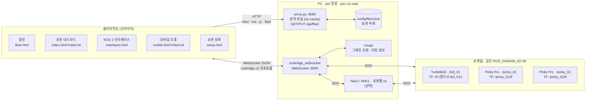

| 구성 요소 | 위치 | 포트 | 역할 |
| --- | --- | --- | --- |
| `serve.py` | PC | 8080 (HTTP) | `ros2-fleet-console/web` 정적 파일 제공(캐시 끔), `/api/fleet` 로봇 목록 읽기·저장(관리자 토큰·입력 검증), `/api/control` 조종 권한(lease) |
| `config/fleet.json` | PC | — | 등록된 로봇: id, 이름, 종류, 네임스페이스, TF 토픽, TF 접두사, 표시 색 |
| `rosbridge_websocket` | PC | 9090 (WS) | 브라우저 JSON ↔ ROS 2 토픽·서비스·액션 변환. 로봇이 몇 대든 하나 |
| `rosapi` | PC | — | 노드·토픽·서비스 목록, 메시지 타입 정의, 시간 조회 (launch 에서 `respawn`) |
| 로봇 bringup | 로봇 | — | 네임스페이스로 실행 (TurtleBot3: `robot/tb3_ns.launch.py` 또는 `namespace:=`, Pinky: `robot/pinky_ns.launch.py`) |
| `nav2_ns.launch.py` | PC | — | (선택) 로봇마다 Nav2 + AMCL 을 네임스페이스로 실행 |

> 로봇이 아니라 PC 에 rosbridge 를 두는 이유: Pi 4 2GB 는 배터리로만 동작하고 여유가 적습니다. JSON 직렬화와 WebSocket 처리를 PC 가 맡습니다.

---

## 2. 실행 구조 (launch)

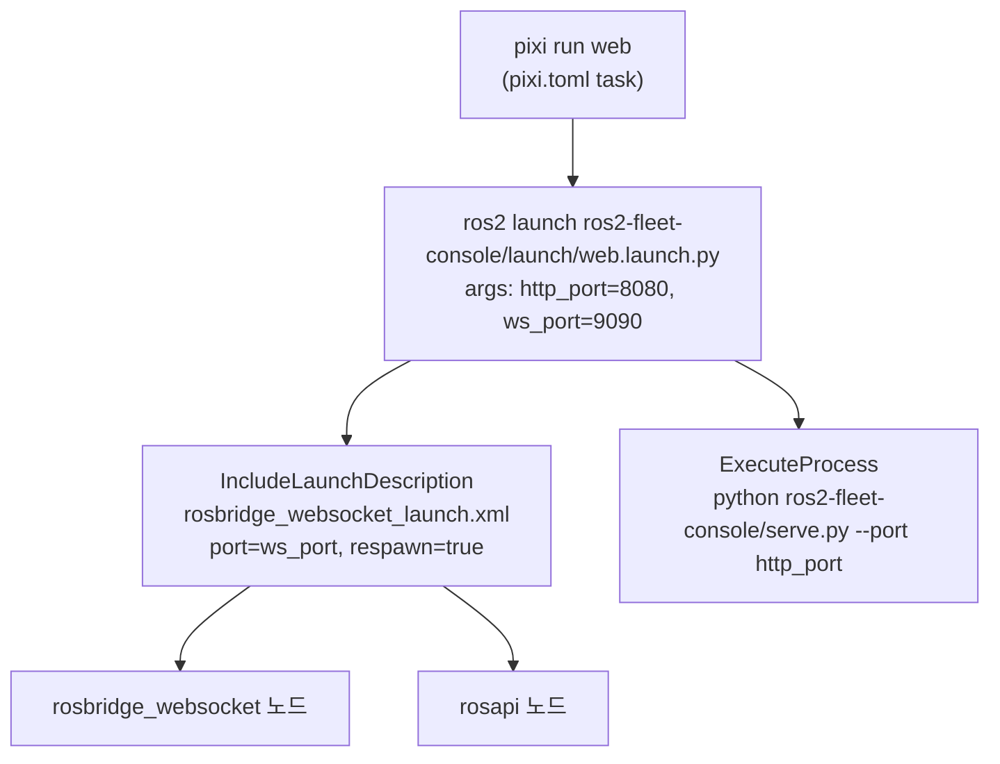

---

## 3. 프론트엔드 모듈

빌드 도구나 외부 JS 라이브러리 없이 순수 HTML/CSS/JS 로 작성했습니다. 각 페이지는 공통 스크립트 위에 페이지 전용 스크립트를 얹습니다.

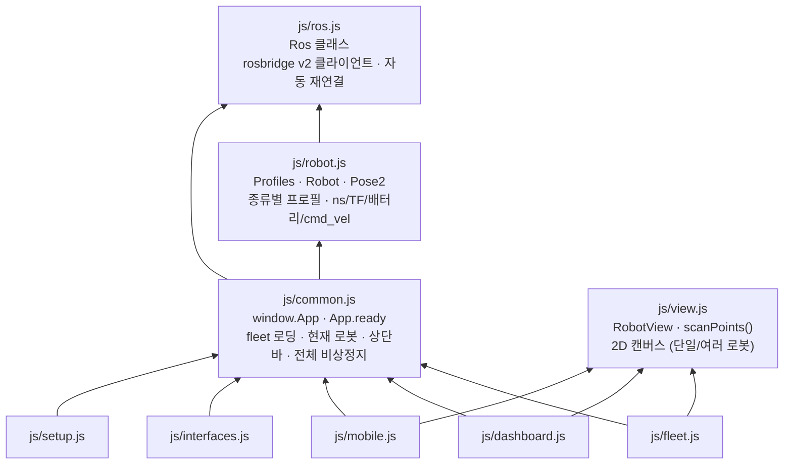

| 파일 | 주요 책임 |
| --- | --- |
| `ros.js` | `subscribe` · `publish`(자동 advertise) · `callService`(Promise·타임아웃) · `sendActionGoal`(피드백 콜백·`cancel()`), 재연결 시 구독·advertise 복원, 같은 토픽 구독을 하나로 합침(멀티플렉싱) |
| `robot.js` | 로봇 종류 프로필(속도 제한, cmd_vel 기본 타입, 배터리 토픽, 장치 서비스)과 `Robot` 클래스: `topic(name)` 으로 ns 붙이기, odom·배터리·TF 구독, `mapPose`, `cmdVel()`·`halt()`, 서비스 존재 확인·호출, `navGoal()` |
| `common.js` | `/api/fleet` 로 로봇 목록을 읽어 `Robot` 생성, `?robot=` 으로 현재 로봇 결정, rosbridge 주소, 지연 측정, 현재 로봇 배터리, **전체 비상정지**, goal 추적, 토스트. 페이지 스크립트는 `App.ready` 이후 시작 |
| `view.js` | 격자·점유 지도·LiDAR·궤적·경로·목표·로봇을 캔버스에 그림. `state.robots` 가 있으면 여러 로봇을 각자 색으로 표시. 끌어서 이동·휠 확대·목표 지정, `robotUp` 모드 |
| `fleet.js` | 모든 로봇 구독, 카드·공유 지도·선택 로봇 패널·종류별 장치·비교 표·이벤트 |
| `dashboard.js` | 한 로봇의 실시간 뷰(`map` 또는 `<접두사>odom` 프레임), 조종, Nav2 goal, 토픽 주기, 로그 |
| `interfaces.js` | 노드 탐색, 토픽 Echo/발행, 서비스 호출, 액션, 파라미터(rcl_interfaces) 편집, 쓰기 잠금 |
| `mobile.js` | 로봇 전환 칩, 조이스틱 → `<ns>/cmd_vel`, 미니 LiDAR, Pinky 표정·LED |
| `setup.js` | fleet 편집·저장, 네임스페이스 자동 검색, 연결 테스트 |

---

## 4. 페이지별 ROS 인터페이스

### 대시보드 (`index.html`)

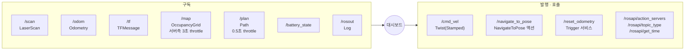

### ROS 2 인터페이스 (`interfaces.html`)

| 기능 | 사용하는 서비스 / op |
| --- | --- |
| 목록 | `/rosapi/nodes`, `/rosapi/topics_and_raw_types`, `/rosapi/services`, `/rosapi/action_servers` |
| 노드 상세 | `/rosapi/node_details` |
| 토픽 Echo | `subscribe` op + `/rosapi/publishers`, `/rosapi/subscribers` |
| 토픽 발행 | `/rosapi/message_details` (기본값 템플릿) + `publish` op |
| 서비스 호출 | `/rosapi/service_type`, `/rosapi/service_request_details` + `call_service` op |
| 액션 | `/rosapi/interfaces` (타입 추정), `/rosapi/action_goal_details` + `send_action_goal` / `cancel_action_goal` op |
| 파라미터 | 각 노드의 `<node>/list_parameters`, `get_parameters`, `describe_parameters`, `set_parameters` (rcl_interfaces) |

파라미터는 rosapi 대신 **노드의 표준 파라미터 서비스를 직접** 호출합니다. rosapi 의 `get_param` 은 값을 문자열로만 주지만, `rcl_interfaces` 는 타입(bool·int·double·배열)과 읽기 전용 여부까지 알려줍니다.

### 모바일 (`mobile.html`)

구독: `/scan`(150ms), `/odom`(200ms), `/battery_state` · 발행: `/cmd_vel`

---

## 5. rosbridge 메시지 흐름

모든 통신은 하나의 WebSocket 위의 JSON 메시지입니다.

| 방향 | op | 용도 |
| --- | --- | --- |
| → | `subscribe` / `unsubscribe` | 토픽 구독. id 는 `sub:<topic>`, `throttle_rate` 로 서버측 간격 제한 |
| ← | `publish` | 구독한 토픽의 메시지 |
| → | `advertise` / `publish` | 토픽 발행 (`/cmd_vel`, Echo 패널 발행) |
| → / ← | `call_service` / `service_response` | 서비스 호출, id 로 응답 매칭 |
| → | `send_action_goal` / `cancel_action_goal` | 액션 goal 전송·취소 |
| ← | `action_feedback` / `action_result` | 피드백, 결과(status 4 성공 · 5 취소 · 6 중단) |

### 원격조종 (데드맨 방식)

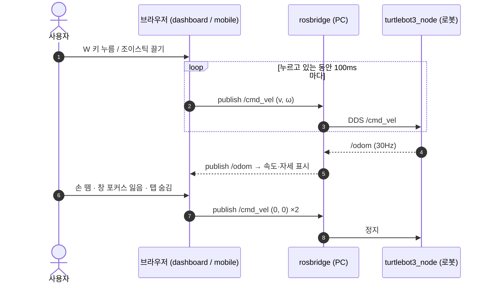

### Nav2 목표 지정

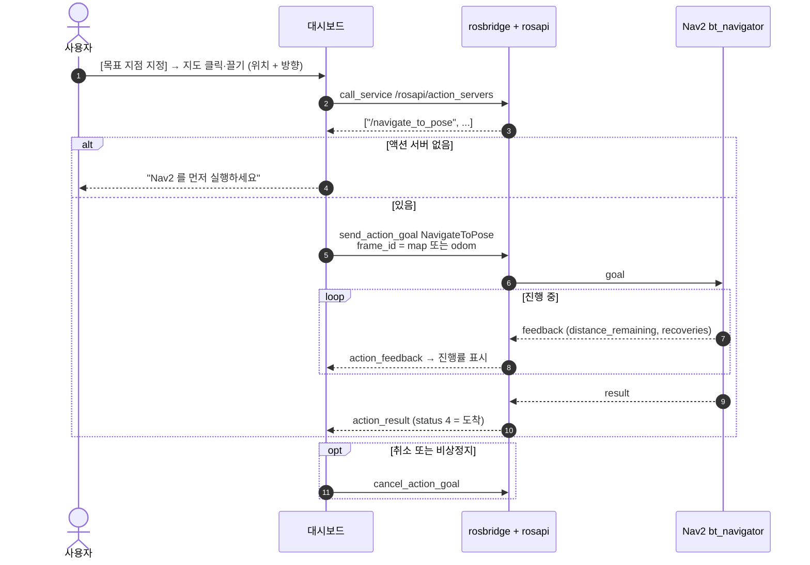

### 파라미터 변경

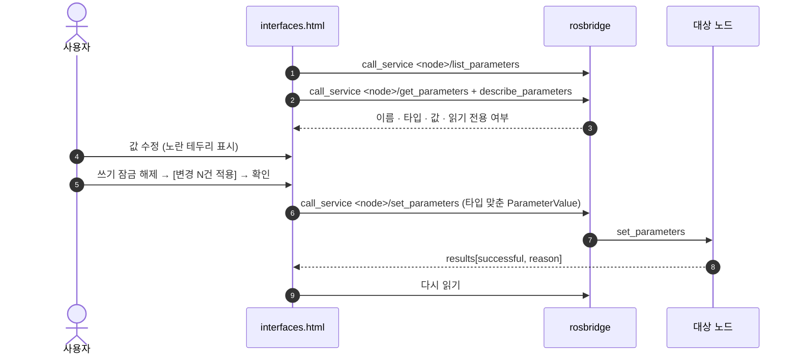

---

## 6. 좌표 프레임 처리 (실시간 뷰)

뷰는 하나의 **표시 프레임**에서 모든 것을 그립니다. `map → odom` TF 가 최근 10초 안에 들어왔으면 `map`, 아니면 `odom` 입니다.

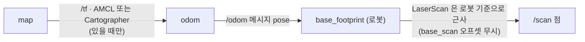

| 데이터 | 원래 프레임 | 표시 프레임으로 바꾸는 방법 |
| --- | --- | --- |
| 로봇 자세 | odom | `T(display←odom) ∘ odom_pose` |
| LiDAR 점 | 로봇 | 현재 로봇 자세로 변환 |
| `/map` | map (header) | 표시 프레임이 odom 이면 `inverse(T map→odom)` 적용 |
| `/plan` | header 프레임 (보통 map) | 위와 같음 |
| 목표 지점 | 표시 프레임 | 그대로 `frame_id` 로 전송, Nav2 가 TF 로 변환 |

표시 프레임이 바뀌면(예: AMCL 시작) 이전 궤적은 지웁니다.

---

## 7. 안전 설계

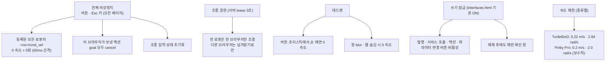

- 비상정지는 **소프트웨어 정지**입니다. 모터 전원 차단이 필요하면 `/motor_power` 서비스(false)를 호출합니다.
- 다른 브라우저나 다른 노드가 보낸 goal·명령은 이 페이지의 비상정지로 취소되지 않습니다.
- rosbridge 에 인증이 없으므로 **신뢰할 수 있는 네트워크에서만** 사용합니다 (9090 포트를 외부에 열지 않기).

---

## 8. 연결 · 장애 처리

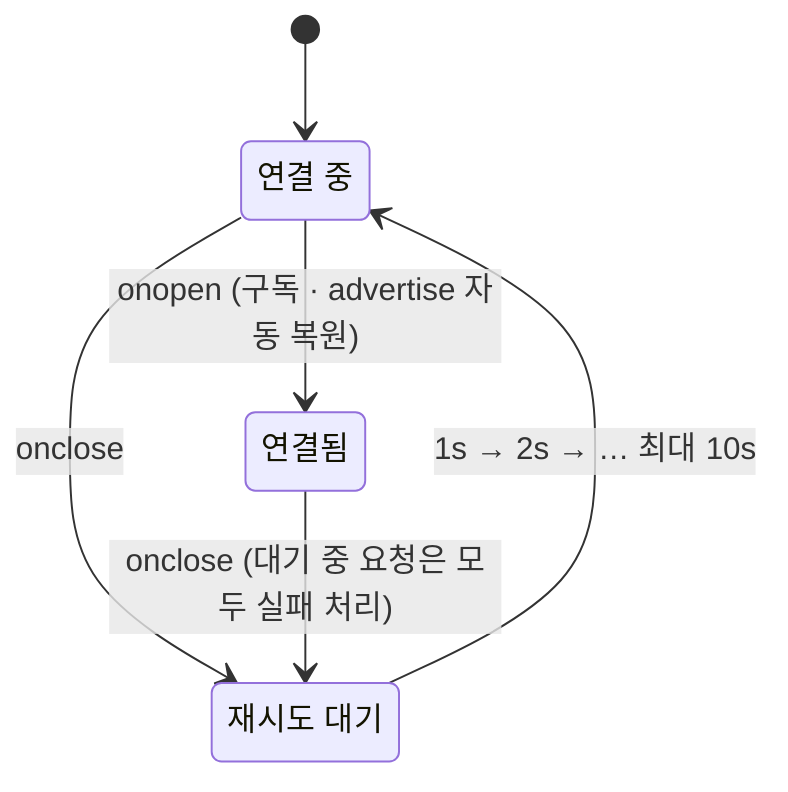

| 상황 | 동작 |
| --- | --- |
| rosbridge 끊김 | 상단 배지 "연결 끊김 · 재시도 중", 지수 백오프로 재연결 |
| rosapi 노드 종료 | launch 의 `respawn=true` 로 다시 시작 |
| 로봇 토픽 끊김 | 최근 5초 안에 odom 공백이 1초를 넘으면 "연결 불안정", 5초 넘게 없으면 "오프라인" |
| 로봇이 페이지보다 늦게 켜짐 | 온라인이 되는 순간 `<ns>/cmd_vel` 타입과 서비스 목록을 다시 확인 (빈 결과면 2초 간격 5회 재시도) |
| 두 브라우저가 같은 로봇 조종 | 먼저 잡은 쪽이 조종, 다른 쪽은 거부 + 넘겨받기. 넘겨받기를 당한 쪽은 입력이 자동 해제 |
| `/cmd_vel` 타입 | 연결 시 `/rosapi/topic_type` 으로 확인. 알 수 없으면 Jazzy 기본 `TwistStamped` |

### 알려진 제약

- rosbridge 2.7.1(RoboStack) 의 `/rosapi/action_type` 은 Jazzy rclpy 에 없는 API 를 써서 **rosapi 노드를 종료**시킵니다. 앱은 이 서비스를 호출하지 않고 `/rosapi/interfaces` 목록에서 이름으로 액션 타입을 추정합니다.
- rosapi 는 숨김 토픽·서비스(`/_action/…`)를 보여주지 않아 **노드별 액션 서버를 구분할 수 없습니다**. 액션은 전체 목록(액션 탭)으로만 봅니다.
- `/map` 은 rosbridge PNG 압축(`compression: "png"`)으로 받고 브라우저에서 풉니다 (1000×1000 격자 2.97 MB → 44 KB, 68배). 3초 간격.

---

## 9. 디렉터리 구조

```text
ros2-fleet-console/
├── README.md
├── config/
│   ├── fleet.json           로봇 목록 + 활성 지도 (setup.html·지도 화면에서 저장)
│   ├── mode.json            운영 모드
│   ├── maps/ zones/ masks/  지도 · 이동 구역 · 로봇별 keepout 마스크
│   └── patrol/<지도>.json   경비 감지·순회 설정 (순회 간격, 대기 알림 간격)
├── data/alerts.db           경보 (SQLite)
├── docs/
│   ├── architecture.md      ← 이 문서
│   └── test-report.md       로봇 없이 한 시험 결과
├── launch/
│   └── web.launch.py        rosbridge(+rosapi) + serve.py
├── robot/
│   ├── README.md            로봇 쪽 사용법
│   ├── tb3_ns.launch.py     TurtleBot3 네임스페이스 + TF 분리 (로봇에서 실행)
│   ├── pinky_ns.launch.py   Pinky Pro 네임스페이스 + TF 분리 (로봇에서 실행)
│   ├── nav2_ns.launch.py    로봇별 Nav2 + keepout 필터 (PC 에서 실행)
│   ├── nav2_params.py       Nav2 파라미터 고치기 공용 함수
│   ├── mapping_ns.launch.py 로봇 한 대 slam_toolbox
│   ├── coop_mapping.launch.py 여러 로봇 함께 지도 만들기 (PC, 웹이 실행)
│   ├── map_merge_node.py    로봇별 지도 합치기 → /map_merged
│   └── patrol_node.py       경비 노드: 경비 역할 로봇의 자동 순회 + 변화 감지 + 경보 + 장애물 앞 대기 (PC, 웹이 실행)
├── serve.py                 정적 파일 + /api/* + 경비 감시(재시작)
├── maps.py                  지도·구역·마스크·기준 지도 반영, 지도 만들기·경비 프로세스
├── patrol_store.py          모드 · 경비 설정 · 경보 DB
├── roles.py                 로봇 역할(워커·경비) · 경비 상태 (DB robot_roles)
├── coverage.py              경비 순회 지점 자동 생성
└── web/
    ├── fleet.html           플릿
    ├── index.html           로봇 대시보드
    ├── interfaces.html      ROS 2 인터페이스
    ├── mobile.html          모바일 조종
    ├── setup.html           로봇 등록
    ├── mapping.html         지도 만들기 (여러 로봇)
    ├── zones.html           이동 구역
    ├── roles.html           역할 (워커·경비 지정, 시작·멈춤·재개)
    ├── patrol.html          경비 (경보 · 자동 순회 지점 · 감지 설정)
    ├── alerts.html          경보 (모바일)
    ├── css/app.css
    └── js/
        ├── ros.js           rosbridge 클라이언트
        ├── robot.js         프로필 · Robot · Pose2
        ├── common.js        공통 (window.App)
        ├── view.js          캔버스 뷰
        ├── fleet.js, roles.js, dashboard.js, interfaces.js, mobile.js, setup.js, mapping.js, zones.js, patrol.js
```

관련 설정: `pixi.toml` 의 `ros-jazzy-rosbridge-suite` 의존성과 `web` 태스크.

---

## 10. 멀티 로봇 (네임스페이스)

### 이름 규칙

모든 로봇이 같은 `ROS_DOMAIN_ID` 에 있으므로 토픽·서비스·TF 프레임이 겹치지 않게 구분해야 합니다.
TurtleBot3 와 Pinky Pro 는 TF 를 다루는 방식이 달라서, 로봇마다 **TF 토픽**과 **TF 프레임 접두사**를 따로 설정합니다.

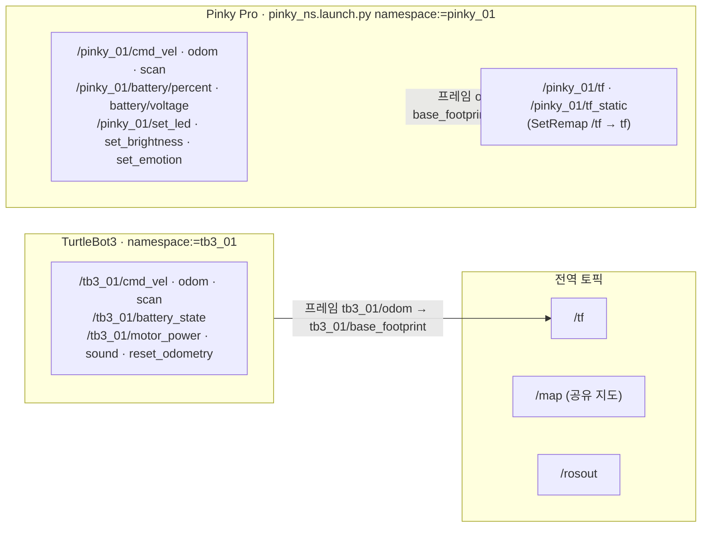

| 종류 | 네임스페이스 | TF 토픽 | 프레임 접두사 | 이유 |
| --- | --- | --- | --- | --- |
| TurtleBot3 (`tb3_ns.launch.py`, Nav2 용) | `/tb3_01` | `/tb3_01/tf` | `tb3_01/` | 네임스페이스 Nav2 가 `<ns>/tf` 를 읽으므로 TF 도 로봇별 토픽으로 |
| TurtleBot3 (`robot.launch.py namespace:=`) | `/tb3_01` | `/tf` | `tb3_01/` | Jazzy bringup 의 `namespace` 인자가 프레임 이름에 접두사를 붙임 (LiDAR 프레임도 `tb3_01/base_scan`) |
| Pinky Pro | `/pinky_01` | `/pinky_01/tf` | (없음) | bringup.py 의 프레임 이름이 고정이라 TF 토픽을 로봇별로 분리 |

### 로봇의 지도 위 자세

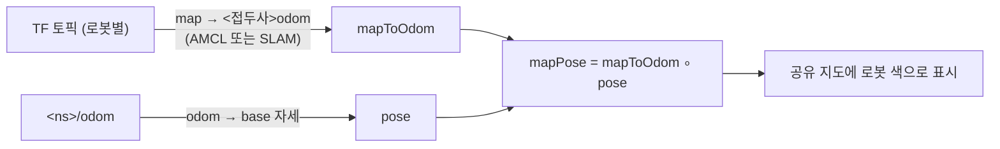

- `map → <접두사>odom` 이 10초 넘게 안 들어오면 지도 위치를 모르는 것으로 보고 카드에 "지도 위치 없음" 을 띄웁니다.
- 오프라인(3초 넘게 `<ns>/odom` 없음)이 되면 마지막 지도 위치를 점선으로 흐리게 남깁니다.
- 경로 `<ns>/plan` 이 odom 프레임이면 mapToOdom 으로 바꿔 그립니다.

### 로봇 등록 흐름

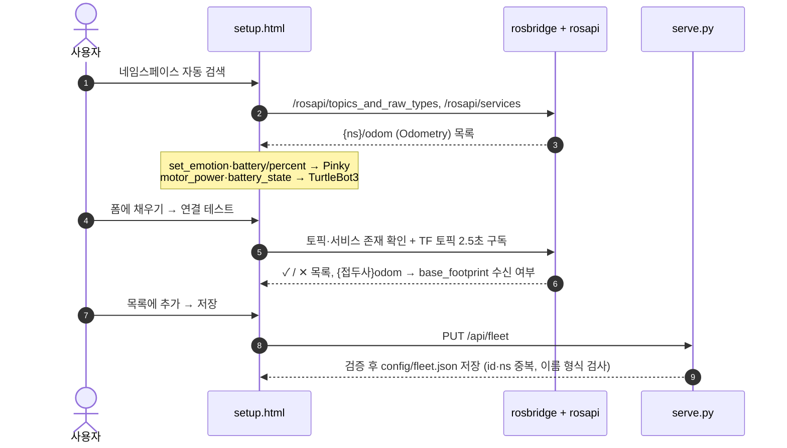

### 플릿 화면 데이터

| 로봇마다 구독 | 간격 | 용도 |
| --- | --- | --- |
| `<ns>/odom` | 서버 0.1초 (최대 10 Hz) | 온라인·불안정 판정, 속도, 자세 |
| 배터리 토픽 (종류별) | 전체 | 카드·표·저전압 이벤트 |
| TF 토픽 | 전체 | map → odom |
| `<ns>/scan` | 서버 2초 (선택 로봇 + LiDAR 레이어 켜면 0.2초) | 수신 확인, 선택한 로봇 LiDAR 표시 |
| `<TF 토픽>_static` | 전체 (transient local) | LiDAR 위치(base_footprint → 스캔 프레임)로 스캔을 실제 위치에 그림 |
| `<ns>/plan` | 서버 1초 | 경로 표시 |
| `/map`(또는 `<ns>/map`), `/rosout`(WARN 이상) | 3초·PNG 압축 / 전체 | 공유 지도, 이벤트 (로거 이름 `tb3_01.amcl` 의 접두사로 로봇 구분) |

로봇 10대(가짜)에서 플릿 화면 수신량은 이 조정으로 523 KB/s → 214 KB/s 로 줄었습니다 ([test-report.md](test-report.md)).

### 로봇별 Nav2 (`robot/nav2_ns.launch.py`)

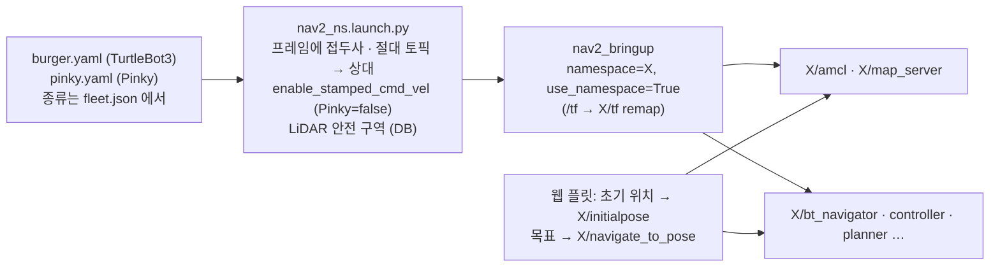

가짜 로봇 2대(TurtleBot3 방식, Pinky 방식)에 Nav2 를 동시에 띄워 AMCL 위치 추정과 목표 도착까지 확인했습니다.

### Pinky Pro 관련 확인 상태

공개 저장소 `pinklab-art/pinky_pro` 의 소스(bringup.py, battery_publisher.py, led_server.py, emotion_server.py, srv 파일)를 보고 작성했습니다.
PC 에서 이름·구조가 같은 가짜 패키지로 `pinky_ns.launch.py`(네임스페이스·TF 분리)와 LED·표정 호출(실제 `pinky_interfaces` 타입)을 확인했고, 실제 Pinky 에서는 아직 시험하지 않았습니다.

---

## 11. 지도 작성과 이동 구역

### 처음 시작 흐름

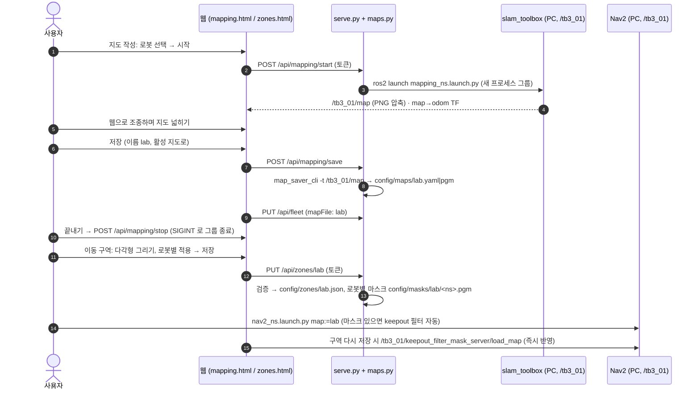

### 마스크 (로봇마다)

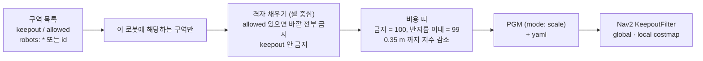

KeepoutFilter 는 금지 셀을 부풀리지 않습니다. 금지 셀만 두면 경로가 경계에 붙고, DWB 는 로봇 몸체가 금지 셀에 닿아 "모든 궤적 충돌"로 멈춥니다.
금지 영역을 넓히는 것으로는 해결되지 않아(경로가 넓힌 경계에 다시 붙음), inflation 과 같은 비용 띠를 마스크에 넣습니다.
costmap 노드는 `/<ns>/global_costmap` 안에 있어 상대 토픽 이름이 그 아래로 풀리므로, 필터 정보·마스크 토픽은 절대 이름(`/<ns>/keepout_…`)을 씁니다.

### 웹 수동 조종 차단 (`Robot.zoneBlocks`)

| 단계 | 내용 |
| --- | --- |
| 입력 | 보내려는 v, ω 와 로봇의 지도 위 자세(map → odom TF + odom) |
| 예측 | 0.6초를 6구간으로 적분한 자세마다 몸체(반지름) 둘레 8점 + 중심이 금지인지 |
| 결과 | 금지면 v=ω=0 으로 바꿔 보내고 `tb3:zone-block` 알림(2초 간격) |
| 예외 | 이미 금지 구역에 걸쳐 있으면 막지 않음(빠져나오기), 지도 위치를 모르면 막지 않음 |

### API

| 요청 | 토큰 | 내용 |
| --- | --- | --- |
| `GET /api/maps` | — | 저장된 지도 목록 (크기·해상도·원점·구역 유무) |
| `GET /api/maps/<이름>.png` | — | 지도 이미지 (웹 색, 미탐색 투명) |
| `GET /api/zones/<이름>` | — | 구역 |
| `PUT /api/zones/<이름>` | 필요 | 구역 저장 + 로봇별 마스크 생성 (구역 64개, 점 200개 이하) |
| `GET /api/mapping` | — | 지도 만들기 상태 (로봇·시작 위치·자동 탐색) |
| `POST /api/mapping/start` `{robots:[{id,x,y,yaw}], explore}` | 필요 | `coop_mapping.launch.py` 시작 |
| `POST /api/mapping/save` `{name}` | 필요 | `map_saver_cli -t /map_merged` 로 저장, yaml 의 image 를 상대 경로로 |
| `POST /api/mapping/stop` | 필요 | 프로세스 그룹 종료 (serve.py 종료 때도 자동) |

경비 관련 API 는 [12. 운영 모드 · 함께 지도 만들기 · 경비](#12-운영-모드--함께-지도-만들기--경비) 참고.

---

## 12. 운영 모드 · 로봇 역할 · 함께 지도 만들기 · 경비

### 모드와 역할

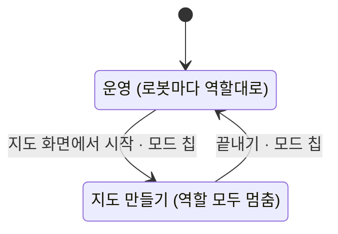

- 모드는 `config/mode.json` (`operate` | `mapping`). 서버를 다시 켜면 운영으로 (예전 `patrol` 도 운영으로).
- 운영 모드에서 로봇마다 역할(`robot_roles`): **워커** = 이동 경로 반복(`route_runner_node`), **경비** = 자동 순회 + 감시(`patrol_node`), 없음 = 수동 조종.
- 지도 만들기로 가면 서버가 이동 경로·경비를 모두 멈춤(paused)으로 바꾸고 실행기·경비 노드를 끕니다.
- 경비 상태(`robot_roles.guard_state`): `stopped` → (시작) `running` ⇄ (멈춤·비상정지·모드·서버 재시작 / 재개) `paused`; `running` → (새 장애물 경보) `alarm` → (경보 처리 또는 재개) `running`.
- `guard_watchdog` 스레드: 운영 모드에서 `running`·`alarm` 인 경비가 있는데 `patrol_node` 가 죽어 있으면 다시 띄움(5초 → 최대 60초 간격), 없으면 끔. `/api/mode` 의 `guard.restarts`·`active`·`alarm` 로 보이고, 모드 칩이 "경비 노드 멈춤"으로 바뀝니다.

### 함께 지도 만들기

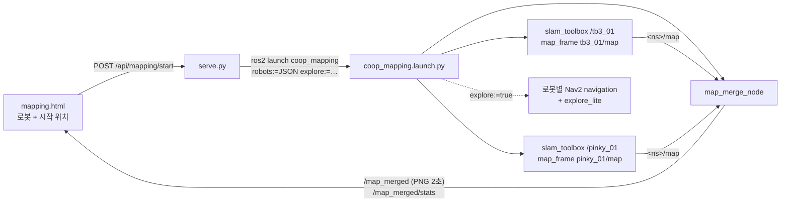

- 웹은 로봇의 합친 지도 위 자세를 `시작 위치 ∘ (<ns>/map → odom, 그 로봇 TF 토픽) ∘ odom` 으로 계산합니다.
- `navigation_launch.py` 는 네임스페이스를 직접 씌우지 않으므로 `PushROSNamespace` 로 감쌉니다 (안 그러면 노드가 `/` 에 떠서 파라미터를 못 찾음 → `No critics defined for FollowPath`).

### 경비 (patrol_node)

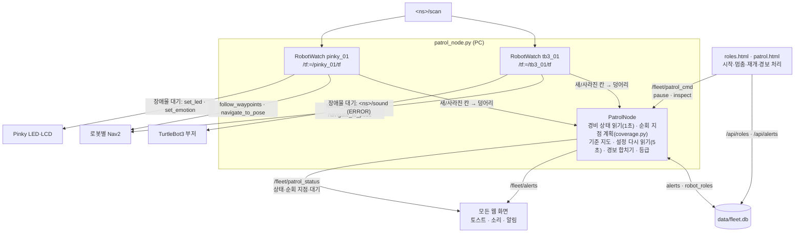

감지 (스캔마다, 0.4초 간격):

| 단계 | 내용 |
| --- | --- |
| 1. 자세 | `map → 스캔 프레임` TF (로봇의 TF 토픽). 없으면 "위치 추정 안 됨" |
| 2. 새로 생긴 것 | 끝점이 기준 지도의 빈 칸이고, 벽에서 `tol` 이상 |
| 3. 사라진 것 | 빛줄기를 따라가며 기준 지도 벽 칸을 지나면 그 칸. 끝점 앞 여유는 표면에서 수직으로 `tol + 칸` (= 빛줄기 따라 `÷ sin(입사각)`). 입사각은 이웃 빛 끝점을 이은 선으로 추정, 25° 미만은 제외. `max_range` 보다 멀리서 돌아온 빛도 그 거리까지는 증거로 씀 (반사 없음 inf 는 제외) |
| 4. 확정 | 칸마다 `persist` 번 이상, 최근 2초 안에 본 것. `decay` 초 안 보이면 잊음 |
| 5. 덩어리 | 8방향 이웃으로 묶음. 넓이 = 감싸는 상자(두께 최소 0.1 m), `min_area` 미만·3칸 미만은 버림 |
| 6. 경보 | 0.5 m 안 같은 종류의 열린 경보가 있으면 갱신(상자 합치기 ≤2 m, 로봇·횟수), 30분 안에 처리한 곳이면 무시, 아니면 새 경보 + 주변 스캔 점(≤400) 저장 |

순회: 경비 중인 로봇들의 지점을 `coverage.plan` 으로 만듦 (갈 수 있는 칸 = 빈 칸에서 몸체 반지름 + 12 cm 여유, 이동 구역 안, 로봇과 이어진 영역 → `spacing` 격자 + 좁은 곳 메우기 → 지그재그 → 로봇 수만큼 이어진 덩어리로 나눔). 로봇 구성·지도·구역·간격이 바뀔 때만 다시 계산. 로봇마다 `follow_waypoints` 로 남은 지점을 보내고(다음 지점을 바라보는 방향), 다 돌면 처음부터. 멈췄다 재개하면 멈춘 지점부터.
장애물 대기: 경비 중에 `new` 경보를 **새로 만들면** `robot_roles` 를 `alarm`(경보 id) 로 바꾸고 goal 취소, `alarm_interval` 마다 부저·LED. 1초마다 그 경보가 열림이 아니면(처리됨) `running` 으로 되돌리고 이어서 돎. `inspect` 는 경비 중인 로봇의 순회를 취소하고 경보에서 로봇 쪽으로 0.6 m 떨어진 곳으로 `navigate_to_pose`, 끝나면 순회로 돌아갑니다. Nav2 가 없으면 "Nav2 없음"으로 기다립니다.

### 경비 API

| 요청 | 토큰 | 내용 |
| --- | --- | --- |
| `GET /api/mode` | — | 모드 + 지도 만들기·경비 프로세스 상태 |
| `POST /api/mode` `{mode}` | 필요 | `operate` / `mapping` |
| `GET /api/roles` | — | 로봇별 역할·경비 상태 + 경비 노드 상태 |
| `PUT /api/roles/<로봇>` `{role}` | 필요 | `worker` / `guard` / `null` |
| `POST /api/roles/<로봇>/guard/start\|resume` | 필요 | 경비 시작·재개 (운영 모드·활성 지도) |
| `POST /api/roles/<로봇>/guard/pause\|stop` | — (같은 출처) | 경비 멈춤·정지 |
| `GET /api/patrol/<지도>` | — | 감지·순회 설정 |
| `PUT /api/patrol/<지도>` `{settings}` | 필요 | 저장 (설정 범위 검사) |
| `GET /api/alerts?map=&status=&limit=&since=` | — | 경보 목록 + 개수 |
| `GET /api/alerts/<id>` | — | 경보 (발견 당시 스캔 점 포함) |
| `POST /api/alerts/<id>` `{status}` | — (같은 출처) | `ok` 이상 없음 / `false` 오탐 / `open` 다시 열기 |
| `POST /api/alerts/<id>/baseline` | 필요 | 기준 지도에 반영 (새 → 벽, 사라진 → 빈 칸 + 붙어 있던 나머지 0.5 m 안), 원본 `.bak` |
