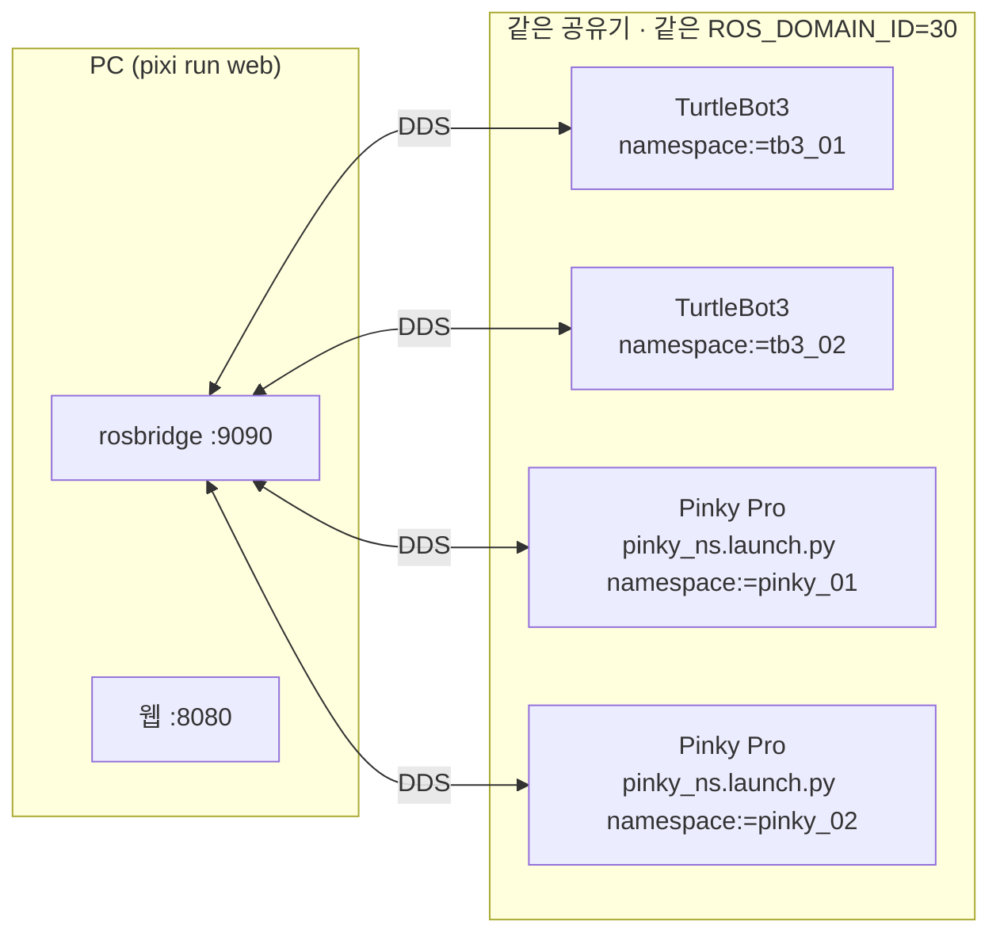
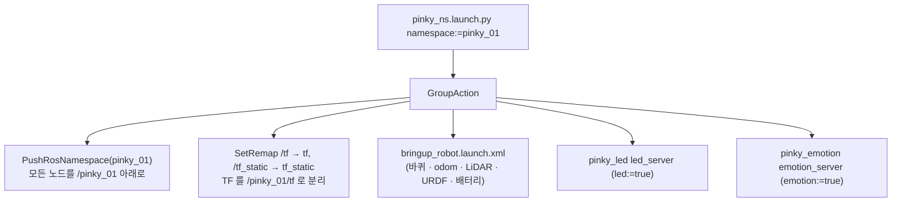

# 로봇 쪽 설정 · 실행 가이드 (멀티 로봇)

웹 관제센터(`ros2-fleet-console/`)로 TurtleBot3 와 Pinky Pro 여러 대를 함께 관제하려면, **로봇마다 다른 네임스페이스로 bringup** 해야 합니다.
이 문서는 각 로봇에서 할 일을 순서대로 정리합니다. PC 쪽 실행과 화면 설명은 [../README.md](../README.md), 구조는 [../docs/architecture.md](../docs/architecture.md) 를 보세요.

> **확인 상태** (PC 에서 가짜 로봇으로 시험한 결과는 [../docs/test-report.md](../docs/test-report.md))
> - TurtleBot3: URDF 프레임 접두사(`tb3_01/base_link` …)와 `tb3_ns.launch.py` 의 TF 분리를 PC 에서 실제 `turtlebot3_state_publisher` 로 확인했습니다. LiDAR 드라이버(`ld08_driver`)도 소스상 `namespace/base_scan` 으로 접두사를 붙입니다. 실제 로봇 bringup 은 아직 시험하지 않았습니다.
> - Pinky Pro: `pinky_ns.launch.py` 를 실제 파일 구조·이름이 같은 가짜 패키지로 실행해 네임스페이스와 TF 분리를 확인했습니다. **실제 Pinky 에서는 아직 시험하지 않았습니다.**
> - 로봇별 Nav2(`nav2_ns.launch.py`): TurtleBot3 방식 1대 + Pinky 방식 1대를 동시에 띄워 AMCL 위치 추정과 목표 도착까지 확인했습니다 (가짜 로봇).

---

## 목차

1. [한눈에 보기](#1-한눈에-보기)
2. [공통 준비](#2-공통-준비-모든-로봇)
3. [TurtleBot3](#3-turtlebot3)
4. [Pinky Pro](#4-pinky-pro)
5. [웹에 등록](#5-웹에-등록)
6. [자동 실행 (선택)](#6-부팅-시-자동-실행-선택)
7. [Nav2 · 공유 지도](#7-nav2--공유-지도)
8. [문제 해결](#8-문제-해결)
9. [점검표](#9-점검표)

---

## 1. 한눈에 보기



| 로봇 | 로봇에서 실행할 명령 | 웹 등록 값: 네임스페이스 / TF 토픽 / TF 접두사 |
| --- | --- | --- |
| TurtleBot3 (**Nav2 함께**, 권장) | `ros2 launch ~/tb3_ns.launch.py namespace:=tb3_01` | `/tb3_01` / `/tb3_01/tf` / `tb3_01/` |
| TurtleBot3 (조종·모니터링만) | `ros2 launch turtlebot3_bringup robot.launch.py namespace:=tb3_01` | `/tb3_01` / `/tf` / `tb3_01/` |
| Pinky Pro | `ros2 launch ~/pinky_ns.launch.py namespace:=pinky_01` | `/pinky_01` / `/pinky_01/tf` / (비움) |
| 로봇 1대만 (기존 방식) | 네임스페이스 없이 bringup | (비움) / `/tf` / (비움) |

이 폴더의 파일:

| 파일 | 어디서 실행 | 하는 일 |
| --- | --- | --- |
| [`tb3_ns.launch.py`](tb3_ns.launch.py) | TurtleBot3 | `robot.launch.py namespace:=X` + TF 를 `/X/tf` 로 분리 (Nav2 네임스페이스 모드와 맞춤) |
| [`pinky_ns.launch.py`](pinky_ns.launch.py) | Pinky Pro | Pinky bringup + LED·표정 서버를 `/X` 아래로, TF 를 `/X/tf` 로 분리 |
| [`nav2_ns.launch.py`](nav2_ns.launch.py) | PC | 로봇 1대의 Nav2 를 네임스페이스로 실행 (파라미터의 프레임·토픽을 로봇에 맞게 자동 수정) |

**네임스페이스 이름 규칙**: 영문자로 시작하고 영문·숫자·`_` 만 씁니다 (`tb3_01` ○, `tb3-01` ✕, `1tb3` ✕). 로봇마다 달라야 합니다.

---

## 2. 공통 준비 (모든 로봇)

### 2-1. 같은 네트워크

PC 와 모든 로봇이 **같은 공유기(같은 서브넷)** 에 있어야 DDS 가 서로를 찾습니다.
Pinky Pro 는 처음에 자체 AP 모드(웹 UI `http://192.168.4.1:8080`)로 동작할 수 있으니, Pinklab 안내에 따라 PC 와 같은 공유기에 붙여 주세요.

```bash
# 로봇에서: 내 IP 확인
hostname -I
# PC 에서: 로봇에 닿는지
ping <로봇 IP>
```

### 2-2. 같은 ROS_DOMAIN_ID

PC 의 pixi 환경은 `ROS_DOMAIN_ID=30` 입니다 (`pixi.toml`). **모든 로봇도 30** 이어야 합니다.

```bash
# 로봇에서 확인
echo $ROS_DOMAIN_ID
# 없거나 다르면 ~/.bashrc 에 추가 후 새 터미널
echo 'export ROS_DOMAIN_ID=30' >> ~/.bashrc
```

TurtleBot3 는 `temp/sbc_setup/tb3_jazzy_sbc_setup.sh` 로 설치했다면 이미 `~/.bashrc` 에 30 으로 들어 있습니다.

### 2-3. 시간 동기화

Raspberry Pi 에는 RTC 가 없어 부팅 직후 시간이 틀릴 수 있습니다. 시간이 크게 어긋나면 TF·Nav2 가 메시지를 버립니다.

```bash
timedatectl            # "System clock synchronized: yes" 인지 확인
```

`no` 면 인터넷 연결 후 잠시 기다리거나, PC 를 NTP 서버로 쓰도록 chrony 를 설정합니다.

### 2-4. ROS 2 버전

PC 와 로봇 모두 **ROS 2 Jazzy** 입니다 (TurtleBot3: Ubuntu 24.04 + apt, Pinky Pro: Ubuntu 24.04 + Jazzy).

---

## 3. TurtleBot3

### 3-1. 실행

로봇별 Nav2 를 쓸 계획이면 `tb3_ns.launch.py` 를, 조종·모니터링만 하면 기본 bringup 을 씁니다 ([7장](#7-nav2--공유-지도) 참고).

```bash
# PC 에서 한 번만: 래퍼를 로봇으로 복사
scp ~/turtlebot3/app/robot/tb3_ns.launch.py <사용자>@<TurtleBot3 IP>:~/

# TurtleBot3 (Raspberry Pi) 에서 — Nav2 와 함께 (TF 가 /tb3_01/tf 로)
ros2 launch ~/tb3_ns.launch.py namespace:=tb3_01

# 또는 조종·모니터링만 (TF 는 전역 /tf)
ros2 launch turtlebot3_bringup robot.launch.py namespace:=tb3_01
```

`TURTLEBOT3_MODEL=burger`, `LDS_MODEL=LDS-02` 환경 변수가 필요합니다 (설치 스크립트가 `~/.bashrc` 에 넣어 둠).

### 3-2. 네임스페이스를 주면 바뀌는 것

| 항목 | 네임스페이스 없음 | `namespace:=tb3_01` |
| --- | --- | --- |
| 토픽 | `/cmd_vel`, `/odom`, `/scan`, `/battery_state`, `/imu` … | `/tb3_01/cmd_vel`, `/tb3_01/odom`, `/tb3_01/scan` … |
| 서비스 | `/motor_power`, `/sound`, `/reset_odometry` | `/tb3_01/motor_power`, `/tb3_01/sound`, `/tb3_01/reset_odometry` |
| TF 토픽 | `/tf` | `/tf` (그대로, 전역) — `tb3_ns.launch.py` 로 실행하면 `/tb3_01/tf`, `/tb3_01/tf_static` |
| TF 프레임 | `odom`, `base_footprint`, `base_link`, `base_scan` | `tb3_01/odom`, `tb3_01/base_footprint`, `tb3_01/base_link` … |
| cmd_vel 타입 | `geometry_msgs/msg/TwistStamped` (Jazzy 기본) | 같음 (웹이 연결 시 자동 확인) |

TurtleBot3 bringup 은 `turtlebot3_node` 의 `namespace` 파라미터로 odom 프레임에, `robot_state_publisher` 의 URDF 에 접두사를 붙입니다. 그래서 TF 토픽은 전역 `/tf` 를 함께 써도 프레임 이름이 겹치지 않습니다.

### 3-3. 확인 (PC 에서)

```bash
cd ~/turtlebot3
pixi run ros2 topic list | grep tb3_01
pixi run ros2 topic hz /tb3_01/odom          # 약 30 Hz
pixi run ros2 run tf2_ros tf2_echo tb3_01/odom tb3_01/base_footprint
```

### 3-4. 짧게 움직여 보기 (PC 에서, 바닥에 내려놓고)

```bash
# 0.05 m/s 로 1번 전진 명령 (TwistStamped)
pixi run ros2 topic pub --once /tb3_01/cmd_vel geometry_msgs/msg/TwistStamped "{twist: {linear: {x: 0.05}}}"
# 정지
pixi run ros2 topic pub --once /tb3_01/cmd_vel geometry_msgs/msg/TwistStamped "{}"
```

### 3-5. 키보드 teleop 을 같이 쓸 때

기본 `teleop_keyboard` 는 `/cmd_vel` 로 보냅니다. 네임스페이스 로봇을 조종하려면 다시 매핑합니다.

```bash
pixi run ros2 run turtlebot3_teleop teleop_keyboard --ros-args -r cmd_vel:=/tb3_01/cmd_vel
```

---

## 4. Pinky Pro

Pinky Pro 의 `pinky_bringup/launch/bringup_robot.launch.xml` 에는 namespace 인자가 없고, `bringup.py` 가 TF 프레임 이름을 `odom`, `base_footprint` 로 **고정**합니다.
같은 도메인에 Pinky 가 두 대 이상이면 프레임 이름이 겹치므로, 이 폴더의 [`pinky_ns.launch.py`](pinky_ns.launch.py) 로 감싸서 실행합니다.

### 4-1. 래퍼 launch 가 하는 일



TF 프레임 이름은 그대로 두고(`odom`, `base_footprint`), 로봇마다 **TF 토픽을 따로** 씁니다. Nav2 의 멀티 로봇 예제와 같은 방식입니다.

### 4-2. 설치 (한 번만)

PC 에서 Pinky 로 파일을 복사합니다. 사용자 이름과 IP 는 실제 값으로 바꾸세요.

```bash
# PC 에서
scp ~/turtlebot3/app/robot/pinky_ns.launch.py <사용자>@<Pinky IP>:~/
```

Pinky 에는 `pinky_bringup`, `pinky_led`, `pinky_emotion` 패키지가 빌드·source 되어 있어야 합니다 (Pinklab 기본 설치). 확인:

```bash
# Pinky 에서
ros2 pkg prefix pinky_bringup
ros2 pkg prefix pinky_led
ros2 pkg prefix pinky_emotion
```

### 4-3. 실행

```bash
# Pinky 에서
ros2 launch ~/pinky_ns.launch.py namespace:=pinky_01

# LED·표정 서버 없이 (해당 패키지가 없거나 따로 띄울 때)
ros2 launch ~/pinky_ns.launch.py namespace:=pinky_01 led:=false emotion:=false
```

| 인자 | 기본값 | 설명 |
| --- | --- | --- |
| `namespace` | `pinky_01` | 로봇 네임스페이스 (앞에 `/` 없이) |
| `led` | `true` | LED 서비스 서버(`set_led`, `set_brightness`) 실행 |
| `emotion` | `true` | LCD 표정 서비스 서버(`set_emotion`) 실행 |

원래 README 처럼 `ros2 run pinky_led led_server` 를 **따로** 실행하면 네임스페이스가 붙지 않습니다. 따로 띄우려면 네임스페이스를 직접 줍니다.

```bash
ros2 run pinky_led led_server --ros-args -r __ns:=/pinky_01
ros2 run pinky_emotion emotion_server --ros-args -r __ns:=/pinky_01
```

### 4-4. 네임스페이스를 주면 바뀌는 것

| 항목 | 원래 | `pinky_ns.launch.py namespace:=pinky_01` |
| --- | --- | --- |
| 속도 명령 | `/cmd_vel` (Twist) | `/pinky_01/cmd_vel` (Twist) |
| 오도메트리 | `/odom` | `/pinky_01/odom` |
| LiDAR | `/scan` (RPLIDAR C1) | `/pinky_01/scan` |
| 배터리 | `/battery/percent`, `/battery/voltage` (Float32, 5초) | `/pinky_01/battery/percent`, `/pinky_01/battery/voltage` |
| LED | `/set_led`, `/set_brightness` | `/pinky_01/set_led`, `/pinky_01/set_brightness` |
| 표정 | `/set_emotion` | `/pinky_01/set_emotion` |
| TF 토픽 | `/tf`, `/tf_static` | `/pinky_01/tf`, `/pinky_01/tf_static` |
| TF 프레임 | `odom → base_footprint → base_link → rplidar_link` | 같음 (이름 고정) |

### 4-5. 확인 (PC 에서)

```bash
cd ~/turtlebot3
pixi run ros2 topic list | grep pinky_01
pixi run ros2 topic hz /pinky_01/odom                  # 약 30 Hz
pixi run ros2 topic echo --once /pinky_01/battery/percent
pixi run ros2 service list | grep pinky_01             # set_led, set_emotion …
# TF 는 네임스페이스 토픽에 있으므로 tf2_echo 에 remap 이 필요
pixi run ros2 run tf2_ros tf2_echo odom base_footprint --ros-args -r /tf:=/pinky_01/tf -r /tf_static:=/pinky_01/tf_static
```

웹에서 LED·표정을 부르려면 PC 의 rosbridge 가 `pinky_interfaces` 타입을 알아야 합니다. 이 PC 의 `~/turtlebot3/ros2_ws/src/pinky_interfaces` 에 공개 저장소의 인터페이스 패키지를 넣고 빌드해 두었습니다 (`pixi run build` 또는 `colcon build --packages-select pinky_interfaces`). Pinky 쪽 패키지가 바뀌면 PC 쪽도 같은 버전으로 맞춥니다.

```bash
# PC 에서 LED·표정 직접 호출 (pixi 환경은 ros2_ws 를 자동 source)
pixi run ros2 service call /pinky_01/set_led pinky_interfaces/srv/SetLed "{command: fill, pixels: [], r: 0, g: 80, b: 255}"
pixi run ros2 service call /pinky_01/set_emotion pinky_interfaces/srv/Emotion "{emotion: happy}"
```

### 4-6. 짧게 움직여 보기 (PC 에서)

```bash
pixi run ros2 topic pub --once /pinky_01/cmd_vel geometry_msgs/msg/Twist "{linear: {x: 0.05}}"
pixi run ros2 topic pub --once /pinky_01/cmd_vel geometry_msgs/msg/Twist "{}"
```

Pinky 의 `bringup.py` 는 바퀴 100 RPM(약 0.28 m/s) 을 넘으면 양쪽을 같은 비율로 줄입니다. 웹은 Pinky 속도를 0.2 m/s, 2.0 rad/s 로 더 낮게 제한합니다 (`ros2-fleet-console/web/js/robot.js` 의 `Profiles.pinky.limits`).

---

## 5. 웹에 등록

로봇을 위처럼 실행한 다음 PC 에서:

1. `pixi run web` → 브라우저에서 `http://<PC IP>:8080/setup.html` (로봇 등록)
2. **네임스페이스 자동 검색** → `/tb3_01`, `/pinky_01` … 이 보이고 종류를 추정합니다
   - `set_emotion`, `set_led`, `battery/percent` 가 있으면 Pinky Pro
   - `motor_power`, `sensor_state`, `battery_state` 가 있으면 TurtleBot3
3. **폼에 채우기** → 이름·표시 색 확인 (TF 토픽·접두사는 종류에 맞게 자동 입력)
4. **연결 테스트** → 토픽·서비스·TF 프레임 확인 (✓ / ✕)
5. **목록에 추가** → **저장** → `ros2-fleet-console/config/fleet.json` 에 기록

`fleet.json` 을 직접 편집해도 됩니다.

```json
{
  "mapTopic": "/map",
  "robots": [
    { "id": "tb3_01",   "name": "tb3-01",   "type": "turtlebot3", "ns": "/tb3_01",   "tfTopic": "/tf",          "tfPrefix": "tb3_01/", "color": "#2DD4BF" },
    { "id": "pinky_01", "name": "pinky-01", "type": "pinky",      "ns": "/pinky_01", "tfTopic": "/pinky_01/tf", "tfPrefix": "",        "color": "#FB923C" }
  ]
}
```

| 필드 | 뜻 |
| --- | --- |
| `id` | 웹 내부 식별자, URL `?robot=` 에 사용 (영문 시작, 영문·숫자·`_`) |
| `name` | 화면 표시 이름 |
| `type` | `turtlebot3` 또는 `pinky` (조종 제한·배터리·장치 패널이 달라짐) |
| `ns` | 네임스페이스 (`/tb3_01`), 1대 기존 방식이면 `""` |
| `tfTopic` | 이 로봇의 TF 토픽 (TurtleBot3 `/tf`, Pinky `/<ns>/tf`) |
| `tfPrefix` | TF 프레임 접두사 (TurtleBot3 `tb3_01/`, Pinky `""`) |
| `color` | 지도·카드 표시 색 (`#RRGGBB`) |

---

## 6. 부팅 시 자동 실행 (선택)

로봇 전원을 켜면 바로 bringup 되게 하려면 systemd 사용자 서비스를 씁니다. 아래는 예시이며, ROS 설치 경로와 워크스페이스 경로는 로봇에 맞게 고칩니다.

```ini
# ~/.config/systemd/user/robot-bringup.service  (TurtleBot3 예시)
[Unit]
Description=TurtleBot3 bringup (namespace tb3_01)
After=network-online.target

[Service]
Environment=ROS_DOMAIN_ID=30
Environment=TURTLEBOT3_MODEL=burger
Environment=LDS_MODEL=LDS-02
ExecStart=/bin/bash -lc 'source /opt/ros/jazzy/setup.bash && source ~/turtlebot3_ws/install/setup.bash && ros2 launch turtlebot3_bringup robot.launch.py namespace:=tb3_01'
Restart=on-failure

[Install]
WantedBy=default.target
```

```bash
systemctl --user daemon-reload
systemctl --user enable --now robot-bringup.service
sudo loginctl enable-linger $USER      # 로그인하지 않아도 사용자 서비스 실행
journalctl --user -u robot-bringup -f  # 로그 보기
```

Pinky 는 `ExecStart` 를 `ros2 launch ~/pinky_ns.launch.py namespace:=pinky_01` 로 바꾸고, Pinky 워크스페이스의 `setup.bash` 를 source 합니다.

---

## 7. Nav2 · 공유 지도

웹의 공유 지도에 로봇이 그려지려면 로봇마다 **`map → <접두사>odom` TF** 가 있어야 하고, 목표 지정은 **`<ns>/navigate_to_pose`** 액션으로 보냅니다.
즉 로봇마다 AMCL(위치 추정)과 Nav2 를 그 로봇의 네임스페이스로 띄웁니다. [`nav2_ns.launch.py`](nav2_ns.launch.py) 가 이것을 PC 에서 로봇 1대씩 실행합니다.

> 가짜 로봇(TurtleBot3 방식 1대 + Pinky 방식 1대)으로 두 Nav2 를 동시에 띄워 AMCL 위치 추정 → 웹에서 목표 지정 → 둘 다 도착까지 확인했습니다. 실제 로봇·실제 센서로는 아직 시험하지 않았습니다.

### 7-1. 왜 TF 를 로봇별 토픽으로 보내야 하나

Jazzy `nav2_bringup` 은 네임스페이스 모드에서 Nav2 노드의 `/tf` 를 **`<ns>/tf`** 로 바꿔 읽습니다. 그래서 로봇도 TF 를 `<ns>/tf` 로 보내야 합니다.

| 로봇 bringup | 로봇의 TF 토픽 | 네임스페이스 Nav2 가 보는 TF | 결과 |
| --- | --- | --- | --- |
| Pinky (`pinky_ns.launch.py`) | `/pinky_01/tf` | `/pinky_01/tf` | 맞음 |
| TurtleBot3 (`tb3_ns.launch.py`) | `/tb3_01/tf` | `/tb3_01/tf` | 맞음 |
| TurtleBot3 (`robot.launch.py namespace:=tb3_01`) | `/tf` (전역) | `/tb3_01/tf` | **안 맞음** — Nav2 를 쓸 때는 `tb3_ns.launch.py` 사용 |

### 7-2. `nav2_ns.launch.py` 가 파라미터를 고치는 내용

기본 파라미터는 `turtlebot3_navigation2/param/burger.yaml` 이고, 실행할 때 로봇에 맞게 복사본을 만듭니다.

| 항목 | 원래 값 | TurtleBot3 (`frame_prefix:=tb3_01/`) | Pinky (`frame_prefix` 없음) |
| --- | --- | --- | --- |
| 프레임 (`*_frame`, `*_frame_id`) | `odom`, `base_link`, `base_footprint` | `tb3_01/odom`, `tb3_01/base_link` … | 그대로 |
| 절대 토픽 (`*topic*`) | `/scan`, `/local_costmap/published_footprint` | `scan` 처럼 상대 이름 → `/tb3_01/scan` | 같음 |
| `enable_stamped_cmd_vel` | `true` | `true` (TwistStamped) | **`false`** (Pinky 는 Twist 구독, `stamped:=false`) |

### 7-3. 실행 순서

```bash
# 1) 로봇들: TF 를 로봇별 토픽으로
ros2 launch ~/tb3_ns.launch.py namespace:=tb3_01          # TurtleBot3 에서
ros2 launch ~/pinky_ns.launch.py namespace:=pinky_01      # Pinky 에서

# 2) PC: 로봇마다 Nav2 (같은 지도 파일)
cd ~/turtlebot3
pixi run ros2 launch ros2-fleet-console/robot/nav2_ns.launch.py namespace:=tb3_01 frame_prefix:=tb3_01/ map:=$HOME/map.yaml
pixi run ros2 launch ros2-fleet-console/robot/nav2_ns.launch.py namespace:=pinky_01 stamped:=false map:=$HOME/map.yaml

# 3) PC: 웹
pixi run web
```

| 인자 | 기본값 | 설명 |
| --- | --- | --- |
| `namespace` | (필수) | 로봇 네임스페이스 (`tb3_01`) |
| `frame_prefix` | `''` | TF 프레임 접두사. TurtleBot3 는 `tb3_01/`, Pinky 는 비움 |
| `stamped` | `true` | cmd_vel TwistStamped 여부. Pinky 는 `false` |
| `map` | (필수) | 지도 yaml |
| `params_file` | burger.yaml | 다른 Nav2 파라미터를 쓰려면 지정 (같은 방식으로 고쳐짐) |

4) 웹 등록:
- TF 토픽은 TurtleBot3 `/tb3_01/tf`, Pinky `/pinky_01/tf` 입니다.
- 각 Nav2 가 지도를 `<ns>/map` 으로 내보내므로, 로봇 등록 화면의 **공유 지도 토픽**을 그중 하나(예: `/tb3_01/map`)로 저장합니다.

5) 웹 플릿 화면:
- 로봇을 고르고 **초기 위치**를 누른 뒤, 지도에서 로봇의 실제 위치를 클릭하고 끌어서 방향을 정합니다(`<ns>/initialpose`). AMCL 이 위치를 잡으면 로봇이 지도에 나타납니다.
- 그다음 **목표 지정**을 누르고 지도에서 목표를 찍습니다.

Pinky 의 로봇 크기·속도에 맞는 Nav2 파라미터는 아직 따로 만들지 않았습니다 (burger.yaml 을 그대로 씀). 실제 Pinky 에서 `robot_radius`, 최대 속도 등을 맞추는 것을 권합니다.

---

## 8. 문제 해결

| 증상 | 원인 · 해결 |
| --- | --- |
| 자동 검색에 로봇이 안 보임 | 같은 공유기인지, `ROS_DOMAIN_ID` 가 같은지 확인. PC 에서 `pixi run ros2 topic list` 에 `/<ns>/odom` 이 보여야 함. 방화벽이 UDP 를 막는지 확인 |
| 토픽은 보이는데 데이터가 안 옴 (`hz` 0) | 시간 동기화, Wi-Fi 신호 확인. `ros2 topic hz` 로 로봇 안에서 먼저 확인 |
| 웹에서 카드가 "연결 불안정" | 최근 5초 안에 `/<ns>/odom` 이 1초 넘게 끊긴 적이 있음. Wi-Fi 신호·로봇 CPU 부하 확인 |
| 웹에서 카드가 "오프라인" | `/<ns>/odom` 이 5초 넘게 안 들어옴. 등록한 네임스페이스와 실제 bringup 네임스페이스 철자 확인 |
| 지도에 "지도 위치 없음" | `map → <접두사>odom` TF 없음. AMCL/SLAM 미실행이거나, 등록한 TF 토픽·접두사가 실제와 다름 (등록 화면의 연결 테스트로 확인) |
| 조종해도 안 움직임 | 등록 종류 확인 (TurtleBot3 = TwistStamped, Pinky = Twist). 웹은 로봇이 온라인이 될 때 `<ns>/cmd_vel` 타입을 다시 확인합니다. TurtleBot3 는 `motor_power` 가 꺼져 있지 않은지 확인 |
| Pinky LED·표정 버튼이 꺼져 있음 | `/<ns>/set_led`, `/<ns>/set_emotion` 서비스가 없음 → `led:=true emotion:=true` 로 실행했는지, 서버를 따로 띄웠다면 `__ns` 를 줬는지 확인 |
| Pinky LED·표정 호출이 실패 ("type" 관련 오류) | PC 의 rosbridge 가 `pinky_interfaces/srv/*` 타입을 모름 → `~/turtlebot3/ros2_ws/src/pinky_interfaces` 가 있는지 확인하고 `pixi run build` 후 `pixi run web` 재시작 |
| 조종이 안 되고 "… 이(가) 조종 중입니다" 가 뜸 | 다른 브라우저가 그 로봇을 조종 중 (조종 권한). 상대가 손을 떼면 3초 안에 풀리고, 급하면 **넘겨받기** |
| Nav2 가 "Waiting on external lifecycle transitions" 에서 안 넘어감 | AMCL 초기 위치가 없음 → 웹 플릿 화면에서 **초기 위치** 지정. 로봇 TF 토픽이 `<ns>/tf` 인지(`tb3_ns`/`pinky_ns` 사용) 확인 |
| 같은 네임스페이스로 두 대를 띄움 | 토픽이 섞여 두 로봇이 같이 움직일 수 있음. 즉시 한 대를 끄고 네임스페이스를 다르게 |
| `tb3-01` 같은 이름이 거부됨 | ROS 이름에는 `-` 를 쓸 수 없음 → `tb3_01` |

---

## 9. 점검표

로봇을 새로 추가할 때:

- [ ] PC 와 같은 공유기, `ping` 성공
- [ ] `echo $ROS_DOMAIN_ID` → `30`
- [ ] `timedatectl` → 시간 동기화됨
- [ ] 다른 로봇과 겹치지 않는 네임스페이스로 bringup (TurtleBot3: `tb3_ns.launch.py` 또는 `namespace:=`, Pinky: `pinky_ns.launch.py`)
- [ ] PC 에서 `pixi run ros2 topic hz /<ns>/odom` → 약 30 Hz
- [ ] 웹 `setup.html` 에서 자동 검색 → 연결 테스트 모두 ✓ → 저장
- [ ] `fleet.html` 에서 카드가 "대기", 배터리 표시
- [ ] 바닥에 내려놓고 로봇 대시보드에서 저속으로 짧게 조종 → 손 떼면 정지
- [ ] 전체 비상정지(`Esc`) 로 멈추는지 확인
